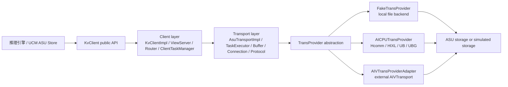
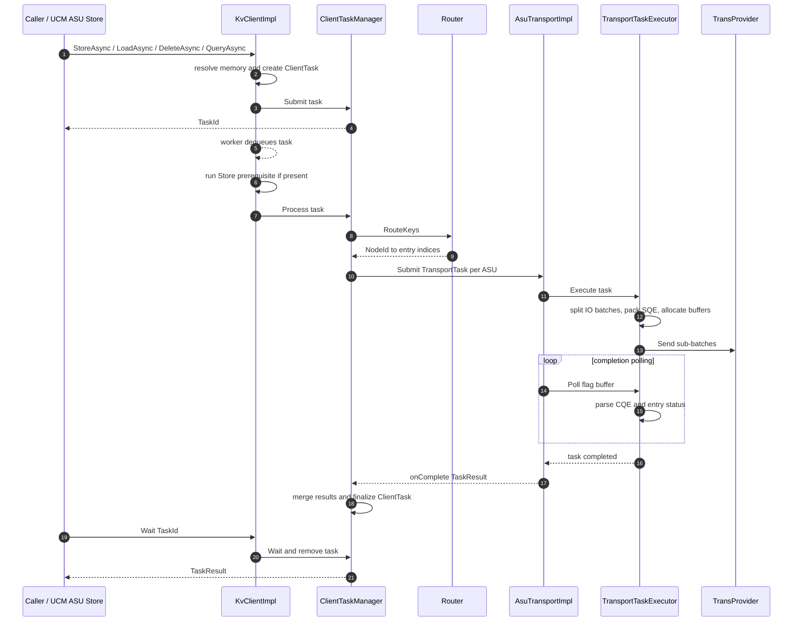

# kv_semantics 设计分析

>
> 分析日期：2026-11-11
>
> 分析对象：当前仓库源码，重点为 `kv_semantics/` 及其在 UCM 中的接入方式。
>
> 结论性质：本文描述当前代码的实际行为；未实现、仅保留编码或仅解析配置的内容会单独标注。

## 1. 总体判断

`kv_semantics` 是 UCM 中面向 ASU/KV 传输的 C++17 客户端模块。它把“对调用方暴露异步 KV API”和“对底层通信后端暴露 Provider 抽象”分开：调用方只依赖 `kv_client` 的稳定接口，传输协议、连接管理、缓冲管理和 AICPU/AIV/Fake 后端适配集中在 `kv_transport`。

当前设计的核心链路是：

```text
KvClient API
  -> ClientTaskManager
  -> Router 按缓存 key 拆分到 ASU
  -> AsuTransportImpl（每个 ASU 一个实例）
  -> TransportTaskExecutor / IoScheduler / BufferManager / ConnectionManager
  -> TransProvider
  -> ASU 或 Fake 后端
```

这个划分的优点是职责边界清楚：Client 层不关心协议编码，Transport 层不直接暴露给业务调用方，Provider 层屏蔽 Hcomm/HIXL/AIV/Fake 的差异。视图、路由和传输实例也被封装成不可变快照，任务提交时固定使用一个 `ViewSnapshot`，避免任务执行过程中被后台视图刷新改变路由目标。

主要风险集中在规模和演进速度上：`TransportConfig` 承载了过多职责；`KvClientImpl`、`AICPUTransProvider`、`kv_protocol.cc` 等文件较大；completion worker 采用遍历所有 in-flight 任务的方式；`LinkProtocol` 已有编码实现但尚未接入主数据路径；CMake 对源码使用 `GLOB` 收集。后文“设计风险与改进建议”逐项展开。

## 2. UCM 与 kv_semantics 的关系

UCM 的整体定位在 `README_zh.md` 中描述为“位于推理引擎与存储之间的统一 KV Cache 层”，负责缓存复用、放置与迁移。`kv_semantics` 对应其中连接 ASU 存储、提交 KV 查询/读写/删除请求的客户端链路。

根目录 `CMakeLists.txt` 通过 `BUILD_UCM_ASU` 控制是否加入该模块：

```cmake
option(BUILD_UCM_ASU "build ucm ASU store module." OFF)
...
if(BUILD_UCM_ASU)
    add_subdirectory(kv_semantics)
endif()
```

因此有两种使用方式：

- 作为 UCM 的 ASU Store 底层库：由 `ucm/store/asu/cc/asu_store.cc` 构造 `kv::KvClientConfig` 并调用 `KvClient`。
- 独立构建 `kv_semantics`：`kv_semantics/CMakeLists.txt` 支持将其作为顶层工程编译，便于测试客户端传输语义。

UCM ASU Store 侧的适配逻辑包括：

- 将 UCM 的 `BlockId` 哈希成 8 字节 `kv::CacheKey`。
- 将 UCM 的配置翻译为 `TransportConfig` 和 `KvClientConfig`。
- 调用 `RegisterRegions` 注册业务内存。
- 将 `kv::Status` 映射为 UCM 的统一 `Status`。
- 根据后端类型补充 AICPU/Fake 相关配置。

`kv_semantics` 并不实现 ASU 服务端的存储语义。服务端行为由 Provider 连接到的后端或 `FakeTransProvider` 的本地文件模拟逻辑承担。

### 2.1 层次结构



## 3. 构建与产物

### 3.1 编译入口

`kv_semantics/CMakeLists.txt` 负责模块级组织：

- 独立构建时设置 C++17、编译选项和依赖。
- 校验 `RUNTIME_ENVIRONMENT`，仅允许 `ascend` 与 `simu`。
- 增加 `metrics`、`src`、`tests`、`kv_test` 子目录。
- 定义 Provider 编译开关。

根构建时由上层 CMake 传入运行环境；独立构建时默认 `RUNTIME_ENVIRONMENT` 为 `ascend`。

### 3.2 核心产物

`kv_semantics/src/CMakeLists.txt` 产出两个共享库：

| 产物 | 职责 | 主要依赖 |
| --- | --- | --- |
| `kv_transport` | 路由后的传输执行、协议编码、连接管理、缓冲池、任务管理和 Provider 适配 | `pthread`、`fmt`、`spdlog`、`zlibstatic`、`kv_metrics`、`kv_buffer_runtime` |
| `kv_client` | 对外异步 API、视图、路由、Client 任务聚合和编排 | `kv_transport`、`pthread`、`kv_metrics` |

依赖方向是：

```text
kv_client -> kv_transport -> TransProvider -> backend
```

`kv_client` 不直接把 Provider 头文件作为公开依赖，调用方只需要 `kv_client.h` 与 `kv_types.h`。

### 3.3 Provider 编译开关

| CMake 选项 | 默认值 | 影响 |
| --- | --- | --- |
| `BUILD_KV_CLIENT_PROVIDER_AICPU` | `OFF` | 定义 `UCM_ASU_ENABLE_AICPU_PROVIDER`，查找并链接 `libhcomm` |
| `BUILD_KV_CLIENT_PROVIDER_FAKE` | `ON` | 定义 `UCM_ASU_ENABLE_FAKE_PROVIDER`，无外部依赖 |
| `BUILD_KV_CLIENT_PROVIDER_AIV` | `OFF` | 定义 `UCM_ASU_ENABLE_AIV_PROVIDER`，查找外部 `libumc.a` |

Provider 选择是“编译宏 + 运行配置”的双重条件。配置选择 `AICPU/AIV/FAKE` 后，如果对应编译宏没有开启，`CreateTransProvider` 会在运行期返回 `UNSUPPORTED`。这是部署和 CI 中必须校验的组合约束。

### 3.4 其他目录的构建状态

`agent/` 和 `patch/` 不是 `kv_semantics/CMakeLists.txt` 当前默认构建的一部分：

- `agent/` 是独立的 Ceph 侧 KV agent 工程，需要外部 Ceph 源码树。
- `patch/` 存放 SGLang、vLLM、LMCache、Dynamo、pynds-kv 等集成补丁。

分析 `kv_semantics` 客户端主链路时，不应把这些目录当作 `kv_client`/`kv_transport` 的组成部分。

## 4. 目录职责

| 目录 | 当前职责 |
| --- | --- |
| `include/` | 对外发布 `KvClient` 接口与 `TaskResult`、内存区域、配置等类型 |
| `src/client/` | Client 实现、任务管理、视图、路由策略和配置解析 |
| `src/trans/` | ASU 传输实例、协议、连接、缓冲、任务执行与调度 |
| `src/trans_provider/` | 传输后端抽象和 Fake/AICPU/AIV 适配 |
| `src/common/` | SPSC 队列、任务管理基类、runtime 抽象、日志等公共工具 |
| `metrics/` | 独立指标库、指标后端、默认指标描述符和 YAML 目录 |
| `kv_test/` | `kv-test` CLI 工具、基准测试、一致性检查和示例配置 |
| `tests/` | Client、Transport、Protocol、Buffer、Connection、Metrics 等单元测试 |
| `agent/` | 独立 Ceph 侧 agent 工程，不进入当前默认构建 |
| `patch/` | 引擎侧集成补丁，不属于客户端运行库 |
| `docs/` | 当前文档与本文 |

## 5. 公共 API 与核心类型

公共头文件只有 `kv_client.h` 与 `kv_types.h`，接口面较窄，便于隔离实现变化。

### 5.1 `KvClient` API

| 方法 | 语义 |
| --- | --- |
| `Init` | 根据 `KvClientConfig` 创建视图、Provider、传输实例和 worker |
| `Shutdown` | 停止接收任务、尝试 drain、释放传输和内存注册状态 |
| `QueryAsync` | 异步查询 key 是否存在，返回 TaskId |
| `LoadAsync` | 异步从 ASU 读入调用方提供的业务缓冲 |
| `StoreAsync` | 异步写入业务缓冲，可选 prerequisite 回调 |
| `DeleteAsync` | 异步删除 key |
| `Check` | 查询任务完成状态，不消费任务 |
| `Wait` | 等待结果并消费任务，超时也会消费任务 |
| `RegisterRegions` | 注册业务内存，返回统一 MR 句柄和 token |
| `UnregisterRegions` | 注销 MR，不等待引用它的任务完成 |

几个容易误用的契约：

- `Wait` 无论成功、失败或超时都会调用 `Remove(taskId)`，之后同一个 TaskId 不能再次等待。
- `Check` 对未知 TaskId 返回 `true`，语义等价于“不再处于未完成状态”，不是“任务存在且成功”。
- `StoreAsync` 的 prerequisite 在 Client worker 上执行，回调阻塞会阻塞后续客户端任务；回调异常会转为 `INTERNAL_ERROR`，任务不再发送。
- `UnregisterRegions` 不会等待已有任务。调用方必须保证队列中或 in-flight 的任务不再引用相关 MR。
- `KVBuffer::mrKey` 由 Client 从注册表中解析，调用方传入的值会被重置并忽略。

### 5.2 核心类型

`kv_types.h` 定义了主要公共数据结构：

- `CacheKey`：固定 8 字节 key。
- `MemoryRegion` / `Buffer` / `KVBuffer`：描述业务内存、MR 句柄和待传输条目。
- `RegisteredMemory`：注册后返回的统一区域信息，包括 MR 句柄和 tokenId。
- `TaskResult`：聚合状态、逐 entry 状态和查询结果。
- `NodeEndpoint` / `NodeInfo`：ASU 端点信息。
- `TransportConfig` / `KvClientConfig`：Client 与 Transport 配置。

协议要求业务 device buffer 和 offset 保持 512 字节对齐，公共头文件中通过 `kAlignmentBytes` 表达。

## 6. Client 层设计

Client 层位于 `src/client/`，由五个主要概念组成：

- `KvClientImpl`：生命周期、内存注册、快照、worker 和对外 API。
- `ViewServer` / `GlobalView`：获取全局视图。
- `Router`：把 key 映射到 ASU。
- `ClientTaskManager` / `ClientTask`：聚合任务生命周期。
- `config_utils`：配置解析和规范化。

### 6.1 `KvClientImpl`

`KvClientImpl` 是 `KvClient` 的唯一生产实现。构造函数可以注入三个工厂：

- `TransportFactory`：创建 `AsuTransport`，便于测试注入假传输。
- `TransProviderFactory`：创建 Provider，便于测试注入假后端。
- `ViewServerFactory`：创建视图服务，便于测试注入动态视图。

初始化流程：

1. 校验是否已初始化、共享 Provider 模式和 Transport 配置。
2. 创建 `ViewServer` 并读取 `GlobalView`。
3. 创建业务内存 Provider。
4. `BuildSnapshot` 为每个 ASU 创建或复用 `AsuTransport`。
5. 建立 Client 任务队列和 worker。
6. 发布快照并标记初始化完成。

关闭流程会：

1. 先停止新的任务提交。
2. 停止并 join client worker、后台视图刷新线程。
3. `ClientTaskManager::Drain` 等待已提交任务。
4. 关闭当前快照和已退役但仍被旧任务引用的传输。
5. 清理注册内存状态。

这种顺序让调用方在 `Shutdown` 返回后可以假设不再有新任务进入链路，但内存注册的生命周期仍需要调用方遵守 API 注释中的约束。

### 6.2 `ViewSnapshot` 与视图刷新

`ViewSnapshot` 是不可变快照：

```cpp
struct ViewSnapshot {
    std::shared_ptr<kv::Router> router;
    std::vector<NodeId> asuIds;
    GlobalView view;
    std::unordered_map<NodeId, std::shared_ptr<AsuTransport>> transports;
};
```

任务提交时会把当前快照的 `shared_ptr` 存入 `ClientTask`，因此后续视图发布不会改变该任务的路由决策。`BuildSnapshot` 会复用旧快照中相同 NodeId 的传输实例，只给新增节点创建新的 Provider 和 `AsuTransport`。

`RefreshView` 的行为：

1. 读取新 `GlobalView`。
2. 通过 `ShouldPublishView` 判断是否发布。已知 viewEpoch 时，只有新 epoch 更大才发布。
3. 构建下一个快照并复用已有成员传输。
4. 将被移除的旧传输放入 `retiredTransports_`，避免旧任务仍在使用时销毁。
5. 原子替换 `snapshot_`。

当状态为 `CONNECTION_ERROR`、`IO_ERROR`、`TIMEOUT`、`NOT_FOUND`、`BUFFER_NOT_REGISTERED`，或任务/entry 状态中出现这些状态时，Client 会启动后台刷新。

当前 `ViewServer` 的默认实现是配置文件或配置内存：

- `view.config_path` 存在时使用 `ConfigFileViewServer`。
- 没有 `viewServiceAddrs` 时从 `transportConfigs` 构建固定视图。
- 有 `viewServiceAddrs` 时当前实现仍将其首个地址当作配置文件路径处理。

因此，“动态视图”目前主要指视图文件可被重新读取、epoch 可增长并被 Client 感知，并不等价于一个已实现的远程视图服务协议。

### 6.3 `ClientTaskManager`

Client 任务是聚合任务：一次 API 请求可能被 Router 拆成多个 ASU 的 `TransportTask`。`ClientTaskManager` 负责它们的创建、分发、结果合并和等待。

处理流程：

1. 将 Client task 状态置为 `INFLIGHT`。
2. `BuildTransportTasks` 提取 key，调用 `Router::RouteKeys` 得到 `NodeId -> original indices`，校验每个 NodeId 都存在对应 `AsuTransport`，并为每个 ASU 复制或移动对应 entry/key。
3. 逐个设置 `onComplete` 和 `onSendComplete` 回调。
4. `DispatchTask` 逐个调用 `AsuTransport::Submit`。
5. Transport 回调 `ClientTaskManager::CompleteTransportTask`。
6. `remainingTransportTasks` 减到 0 后 `Finalize`。
7. `Wait` 唤醒调用方并移除任务。

对 Query，transport 结果会按 `originalIndices` 写回原始位置，并计算连续存在的前缀数量 `prefixHitKeys`。任一 transport task 失败时，聚合 `finalStatus` 为 `PARTIAL_FAILED`，逐 entry 状态仍保留更细粒度信息。

### 6.4 Router

`Router` 输入是 key 数组，输出 `NodeId -> EntryIndex` 映射，不感知 entry 的内存细节。当前有四种策略：

| 策略 | 设计 |
| --- | --- |
| `RingHashRouter` | 虚拟节点一致性哈希 |
| `MaglevRouter` | Maglev 查找表路由 |
| `ContiguousBlockAffinityRouter` | 每 K 个连续 key 绑定到同一 ASU，底层使用 full-spread Router |
| `BatchTopKAffinityRouter` | 每个 batch 先选择 TopK 候选 ASU，再在候选内路由 |

前两者是基础 full-spread 策略；后两者构建在 full-spread 策略或活跃节点集合之上。默认哈希函数是 CRC32 IEEE。

`router/config.h` 已经承认 Router 配置构建依赖 `Status` 是“transitional layering wrinkle”。当前 Router 仍在 `src/client` 内，与 ASU 状态类型耦合，尚未抽成纯通用库。

`dynamicAdjustEnabled` 配置字段会被解析，但当前 Router 执行路径没有完整的动态权重或负载反馈控制面。不应把它理解为已实现的动态重路由能力。

### 6.5 请求生命周期时序



## 7. Transport 层设计

`src/trans/` 的对象模型围绕“每个 ASU 一个传输实例”展开。

### 7.1 `AsuTransportImpl`

`AsuTransport` 是抽象接口，`AsuTransportImpl` 是默认实现。它持有：

- `ConnectionManager`
- `TransportTaskExecutor`
- `TransportTaskManager`
- execute SPSC 队列
- execute worker
- completion worker

初始化流程：

1. 校验 Provider、失败阈值和 poll 参数。
2. 创建 `ConnectionManager`。
3. 为每个 endpoint 添加 connection group。
4. 获取 server capabilities 并收敛 batch 上限。
5. 启动连接恢复线程。
6. 创建并初始化 `TransportTaskExecutor`。
7. 启动 execute worker 与 completion worker。

任务提交后：

1. `TransportTaskManager` 登记 task 并分配 TaskId。
2. task 进入 SPSC execute queue。
3. execute worker 调用 `TransportTaskExecutor::Execute`。
4. completion worker 调用 `TransportTaskExecutor::Poll`。
5. 完成后通过 callback 回传 Client。

`Cancel` 是 best-effort：接口注释说明它不会中断底层 UB/RoCE IO，主要用于标记任务状态和释放尚未完成的 sub-batch 资源。

### 7.2 `TransportTaskExecutor`

`TransportTaskExecutor` 拥有一个 transport 实例的数据路径：

- 创建 send buffer manager。
- 创建 flag buffer manager。
- 注册托管内存。
- 切分 sub-batch。
- 生成协议请求。
- 选择连接。
- 组装 `TransProvider::SendIoBatch`。
- 发送和轮询完成。
- 释放 slot、inflight 计数等资源。

`Execute` 的主流程：

1. CAS 将 task 从 `PENDING` 更新为 `INFLIGHT`。
2. `PrepareTaskSubBatches` 切分并构建请求。
3. `AssignSubBatchConnections` 选择 channel。
4. `BuildSubBatchSendBuffers` 生成 Provider 输入。
5. `SendSubBatchBuffers` 调用 Provider `Send`。
6. 记录 send 完成时间并触发 `onSendComplete`。
7. 保存 sub-batch context 供 completion worker 轮询。

`Poll` 的主流程：

1. 检查 deadline，超时则标记 `TIMEOUT` 并向连接上报失败。
2. 对每个 sub-batch 读取 flag buffer。
3. 解析 CQE CID，只有与当前 sub-batch CID 匹配才继续。
4. `ProtocolManager::UnpackResponse` 解析响应。
5. 将协议状态转换为 sub-batch 和 entry 状态。
6. 根据内部错误或 IO timeout 更新连接健康状态。
7. 释放该 sub-batch 资源，减少剩余计数并尝试 finalize task。

completion worker 每轮调用 `taskManager_.GetAll()`，然后线性遍历所有 in-flight task。这简化了实现，但任务数较大时会成为扩展瓶颈。

### 7.3 `IoScheduler`

`IoScheduler` 只做协议批量限制相关的切分，不做路由：

- `batchLoadIoNum`，默认 110。
- `batchStoreIoNum`，默认 110。
- `deleteIoNum`，默认 254。
- `queryIoNum`，默认 256。

这些配置会在 `AsuTransportImpl::Init` 中与 `ServerKvCapabilities` 的非零上限取较小值，得到实际 batch limit。

### 7.4 `BufferManager`

Transport 有两类托管缓冲：

| 类型 | 用途 |
| --- | --- |
| send buffer | 存放打包后的 SQE 请求 |
| flag buffer | 接收响应头、entry 结果位图或查询结果 |

`BufferManager` 的职责：

- 按 slot 分配和释放。
- 将 slot capacity 对齐到 64 字节 slot stride。
- 支持 `HOST`、`HOST_PINNED`、`DEVICE` 三种内存抽象。
- 将整块内存注册给 Provider。
- 释放 slot 前清零，避免复用时读到旧状态。

`ScatterGatherEntry` 同时携带 CPU 可访问的 `local_addr` 和 Provider 可用的 `device_addr`。`HOST_PINNED` 通过 host-mapped device buffer 实现，本地访问走 host address，Provider 注册时使用 device address。

### 7.5 `ConnectionManager`

`ConnectionManager` 把 endpoint 组织成 `ConnectionGroup`，每个 group 下有多个 `ConnectionChannel`。channel 状态包含 active、draining 等，并维护 inflight 和错误计数。

当前功能：

- 支持 `ROUND_ROBIN` 与 `LEAST_LOADED` 连接选择。
- channel 连续失败达到 `maxErrorCount` 后进入 draining。
- 后台 recover loop 每 100ms 重建失败连接。
- 连接能力查询失败且返回 `UNSUPPORTED` 时允许使用默认配置。
- 根据非零的 `ioQueueDepth` 收敛每 channel 最大 inflight。

`ServerKvCapabilities` 中的 `ioQueueKeyConcurrency`、`connectionKeyConcurrency`、`kvCapabilities` 目前仍标注为 placeholder，说明能力模型还没有完全展开。

## 8. 协议层设计

协议代码位于 `src/trans/proto/`。

### 8.1 KV opcode 与 SQE/CQE

`KvOpcode` 当前包括：

| opcode | 值 | 含义 |
| --- | --- | --- |
| `Store` | `0x1` | 单条写 |
| `Retrieve` | `0x2` | 单条读 |
| `Delete` | `0x8` | 删除 |
| `Exist` | `0xC` | 存在性查询 |
| `BatchStore` | `0x45` | 批量写 |
| `BatchRetrieve` | `0x46` | 批量读 |
| `KeepAlive` | `0xF4` | 保活 |

`ProtocolManager` 按 opcode 聚合具体协议实现，提供：

- `PackRequest`
- `UnpackResponse`
- `PollResponseCid`
- `VerifyPackedBuffer`
- `GetPackedSize`

单条 Store/Retrieve 的 SQE 固定为 16 个 dword。批量协议在固定头后追加 entry 表。响应写入 flag buffer，completion worker 通过 CID 判断响应归属。

协议层将 CQE 状态映射为 `StatusCode` 中的 `CQE_*` 或 entry 级状态，`TransportTaskExecutor` 再将其转换为 `TaskResult.entryStatus`。

### 8.2 `LinkProtocol` 现状

`link_protocol.h/cc` 定义了连接协商相关消息：

- `Negotiate`
- `Handshake`
- `HandshakeDone`
- `Disconnect`

这些类有编码、校验和测试，但当前主数据路径与 `ConnectionManager` 没有直接调用它们。连接创建、能力和发送逻辑主要由 Provider 的连接接口承担。因此应把 `LinkProtocol` 理解为已实现的协议编码基础，而不是当前已接入的 KV 主链路协商机制。

## 9. Provider 层设计

### 9.1 抽象边界

`TransProvider` 是传输后端抽象，接口包括：

- `CreateConnection` / `DeleteConnections`
- `GetServerCapabilities`
- `Send` batch
- `RegisterMemory` / `BindMemory` / `UnregisterMemory`
- `AllocThread` / `FreeThread`
- `GetMemTokenId`

Provider 不理解 `ClientTask`、Router 或 `TaskResult` 聚合，只处理连接、内存和批量 IO。这个边界使 Fake 后端可以完整模拟协议响应，而测试不必依赖真实加速器环境。

### 9.2 三个实现

| 实现 | 状态与用途 |
| --- | --- |
| `FakeTransProvider` | 默认编译开启。本地文件 mock 后端，支持延迟、worker、立即完成等配置，适合 CI 和功能测试 |
| `AICPUTransProvider` | 默认关闭。基于 Hcomm/HIXL/UB/UBG，实现真实 AICPU 传输路径，源码约 1978 行，是复杂度最高的 Provider |
| `AIVTransProviderAdapter` | 默认关闭。包装外部 `AIVTransport` 和 `libumc.a`，将外部接口适配到 `TransProvider` |

`CreateTransProvider` 根据配置的 `TransProviderType` 和编译宏选择实现。配置和宏不匹配时返回明确的 `UNSUPPORTED`。

## 10. Metrics 设计

`kv_metrics` 是独立共享库，通过可插拔后端避免 Client/Transport 直接绑定具体监控系统。

主要组件：

- `CachedMetric`：缓存 metric 绑定。
- `KvMetricsBackend`：后端接口。
- `StandaloneMetricsBackend`：standalone 后端。
- `default_metric_descriptors.h` / `kv_metrics.yaml`：默认指标目录。

指标覆盖：

- Client API 请求、entry 数和错误。
- Client 队列、处理、发送和端到端时延。
- Transport 队列、发送、completion 和端到端时延。
- Connection、timeout、IO 错误。
- 按 ASU node 维度的部分时延。

UCM 侧还有自己的 metrics adapter，`asu_store.cc` 在调用 Client 前后也记录 UCM Store 层的请求和时延。

## 11. `kv-test` 与测试体系

### 11.1 `kv-test`

`kv_test/` 构建 `kv-test` CLI，支持：

- `connect`
- `config check`
- `version`
- `store`
- `retrieve`
- `delete`
- `exist`
- `batch-store`
- `batch-retrieve`
- `power-cycle`
- `bench`

工具内部负责确定性 key/value 生成、缓冲分配、一致性和结果输出，可以在 Fake Provider 上做端到端验证，也保留 AICPU 环境的示例配置。

### 11.2 单元与集成测试

`tests/` 当前覆盖：

- Client 实现、E2E metrics 和 smoke。
- View server。
- SPSC 队列。
- Protocol 编码。
- Buffer manager。
- Connection manager。
- Fake Provider。
- IO scheduler。
- KV submit flow。
- Transport 实现。
- Link protocol。
- Task utils。
- Standalone metrics。

测试分层与代码分层基本一致，Fake Provider 支撑了不依赖真实硬件的闭环验证。

注意：现有 `docs/guide/kv-test.md` 中仍出现旧路径 `ucm/transport/kv/...`。当前仓库实际路径是 `kv_semantics/...`，使用该文档时应以当前目录结构为准。

## 12. 设计优点

1. **公共 API 窄而稳定**：调用方只看到异步 API 和结果类型，协议与 Provider 细节被隔离在 `kv_transport`。
2. **视图快照化**：任务持有提交时的 `ViewSnapshot`，后台刷新不会改变已提交任务的路由目标。
3. **传输实例按 ASU 隔离**：连接、缓冲、队列和 completion 都以 ASU 为边界，故障不会天然影响所有节点的实例。
4. **Provider 可插拔**：Fake 后端可进入 CI，AICPU/AIV 后端按编译宏隔离，避免默认构建依赖外部库。
5. **任务结果分层**：`TaskResult` 同时有聚合状态和 entry 状态，便于调用方区分部分失败。
6. **托管缓冲生命周期清楚**：send/flag buffer 由 `BufferManager` 统一分配、注册、清零和释放。
7. **连接恢复独立化**：channel 失败进入 draining，后台线程周期性重建，避免在发送线程内做复杂恢复。
8. **测试工具完整**：`kv-test` 可以覆盖功能、一致性和基础性能，单元测试覆盖主要子模块。

## 13. 设计风险与改进建议

### 13.1 `TransportConfig` 职责过重

`TransportConfig` 同时包含节点信息、Provider 类型、连接策略、队列容量、超时、批量限制、内存槽配置和 attrs。源码中已有“拆分 Config，按逻辑模块细化”的 TODO。

建议逐步拆成：

- `EndpointConfig`
- `ConnectionConfig`
- `TaskExecutorConfig`
- `BufferPoolConfig`
- `ProviderConfig`
- `KvProtocolConfig`

并在公共配置与内部配置之间建立显式转换层，避免调用方理解所有底层字段。

### 13.2 大文件继续增长

以下文件已经承担多个职责，后续演进容易继续膨胀：

- `src/client/kv_client_impl.cc`，约 950 行。
- `src/trans/proto/kv_protocol.cc`，约 1270 行。
- `src/trans_provider/aicpu/aicpu_trans_provider.cc`，约 1980 行。

建议优先拆分：

- Client：生命周期、内存注册、快照构建、worker。
- AICPU Provider：连接、内存、batch workspace、HIXL launch。
- KV protocol：按 opcode 文件或通过生成器统一布局。

### 13.3 Completion 轮询的复杂度

每个 `AsuTransportImpl` 的 completion worker 都调用 `GetAll()` 并线性轮询所有 in-flight task。当单 ASU 并发任务多时，轮询成本随任务数线性增长。

短期可以利用 Provider 的 completion event 或按 flag buffer 建立索引；中期应引入完成队列或事件驱动模型，避免每轮扫描全量任务。

### 13.4 Router 的分层与动态化

`router/config.h` 明确标注 `Status` 依赖是过渡性分层瑕疵。`dynamicAdjustEnabled` 目前主要是配置字段，尚未形成完整的反馈控制面。

建议将 Router 下沉为纯路由组件，输入输出只使用通用错误类型；动态调整如果保留，应明确输入信号（负载、延迟、失败率）和调整决策的位置。

### 13.5 `LinkProtocol` 与主链路的关系需要明确

`LinkProtocol` 的 Negotiate/Handshake/Disconnect 编码已实现并有测试，但未接入当前主链路。若未来要使用，应补充连接状态机和 Provider 交互点；若不计划接入，应从主构建说明中降低其位置，避免读者误判。

### 13.6 Provider 编译与运行配置的耦合

配置选择某 Provider 而未编译对应宏时，错误要到创建 Provider 时才暴露。建议在 CMake configure 阶段输出组合校验信息，并在文档中给出必须同时设置的 CMake 选项和运行配置示例。

### 13.7 CMake 使用 `GLOB`

`src/CMakeLists.txt` 用 `file(GLOB ... CONFIGURE_DEPENDS)` 收集源码。虽然 `CONFIGURE_DEPENDS` 能触发重新配置，但显式源码列表对构建稳定性、迁移和依赖分析更友好。规模继续增长后建议改为显式列表或统一的 source manifest。

### 13.8 API 生命周期约定依赖调用方

`UnregisterRegions` 不等待任务，`Wait` 超时即消费任务，`Check` 对未知 TaskId 返回 true。这些约定在头文件中已说明，但组合使用仍容易出错。

建议在调试模式下增加 MR 引用追踪或断言，帮助发现“任务仍引用已注销内存”的问题；同时考虑文档中的任务状态图，明确 submit、in-flight、completed、consumed 的转换。

### 13.9 文档路径滞后

`docs/guide/kv-test.md` 使用旧的 `ucm/transport/kv/...` 路径，而当前源码和 CMake 路径为 `kv_semantics/...`。应统一更新，避免使用者按文档找不到构建入口。

## 14. 关键调用链速查

### 14.1 Client 聚合链路

```text
KvClientImpl::QueryAsync / LoadAsync / StoreAsync / DeleteAsync
  -> KvClientImpl::SubmitAsync
  -> ClientTaskManager::Submit
  -> SpscRingQueue
  -> KvClientImpl::WorkerLoop
  -> prerequisite callback (Store only)
  -> ClientTaskManager::Process
  -> ClientTaskManager::BuildTransportTasks
  -> Router::RouteKeys
  -> ClientTaskManager::DispatchTask
  -> AsuTransport::Submit
  -> ClientTaskManager::CompleteTransportTask
  -> ClientTaskManager::Finalize
  -> ClientTaskManager::Wait / Check
```

### 14.2 Transport 数据链路

```text
AsuTransportImpl::Submit
  -> TransportTaskManager::Submit
  -> executeQueue
  -> AsuTransportImpl::WorkerLoop
  -> TransportTaskExecutor::Execute
  -> IoScheduler::SplitForAsu
  -> sqe_request.cc build request
  -> BufferManager::Allocate send/flag slot
  -> ConnectionManager::SelectConnection
  -> TransProvider::Send
  -> AsuTransportImpl::CompletionLoop
  -> TransportTaskExecutor::Poll
  -> ProtocolManager::PollResponseCid
  -> ProtocolManager::UnpackResponse
  -> TransportTaskManager::NotifyCompletion
  -> Client callback
```

### 14.3 视图刷新链路

```text
Wait / task status / memory registration failure
  -> ViewServer::ShouldRefreshView
  -> KvClientImpl::RequestBackgroundRefresh
  -> KvClientImpl::RefreshView
  -> ViewServer::GetGlobalView
  -> ViewServer::ShouldPublishView
  -> KvClientImpl::BuildSnapshot
  -> reuse transports for unchanged NodeId
  -> create transports for new NodeId
  -> retire removed transports
  -> publish snapshot_
```

## 15. 结论

`kv_semantics` 的当前架构是清晰的：Client 负责 API 语义、任务聚合和路由，Transport 负责每个 ASU 的协议执行和连接/缓冲管理，Provider 负责后端差异。不可变视图快照、按 ASU 隔离的传输实例和 Fake Provider 是支撑可测试性与可扩展性的关键设计。

后续最值得投入的演进方向是：拆分大配置和大实现文件，优化 completion 轮询，明确 View 与 Link 协议的实际定位，收敛 Provider 构建校验，并把历史文档路径与当前仓库结构统一。
