# M800 视图管理设计

> 设计对象：`kv_semantics` KVClient  
> 输入：[UCM M800视图管理Story设计提示词.md](./UCM%20M800视图管理Story设计提示词.md)  
> 基线：当前仓库源码实现  
> 版本：2026-11-15

## 1. 设计范围与已确认决策

本文补充 M800 视图管理的实现思路，覆盖多命名空间视图拉取、Master/Worker 视图分发、per-ns 快照、transport 全局池化、RefreshScheduler 和默认二次哈希故障转移。

当前仓库的公共 IO API 尚未携带 `KvNsId`。本设计沿用外部分支已完成或计划完成的 API 前提：四个 IO 命令的入参均包含 `KvNsId nsId`，本文只设计该参数在客户端内部的使用方式，不重新设计兼容旧 API 的过渡方案。

已确认的设计决策如下。

| 决策点            | 结论                                                             |
| -------------- | -------------------------------------------------------------- |
| `KvNsId` API   | 假定带 `KvNsId` 的 IO API 已在其他分支完成，本设计沿用                           |
| Agent ABI      | 新增 C ABI 导出 `get_all_ns_name` / `get_view_by_ns` / `get_epoch` |
| Transport 生命周期 | transport 常驻全局池，仅在 `Shutdown` 时关闭                              |
| `KvNsId` 生成    | 由 Ceph pool 名称通过固定 XXHASH32 生成                                 |

其中 `KvNsId` 定义为：

```cpp
KvNsId = XXH32(pool_name_utf8_bytes, pool_name_size, 5381);
```

seed 固定为 `5381`，已在 `kKvNsIdHashSeed` 中冻结，必须在 Master、Worker、上层调用方和存储侧保持一致。Master 初始化和每次刷新时必须做冲突检测：如果两个不同 pool name 得到同一个 `KvNsId`，本次拉取失败，保留旧视图，禁止静默覆盖。

提示词中提到的 `retiredTransports_` 常规回收机制不再适用于 M800。按已确认决策，transport 由全局池唯一持有，视图变更只改变快照引用，不关闭连接；`Shutdown` 在 drain 已提交任务后统一关闭池内全部 transport。

## 2. 当前实现与 M800 差异

当前 `ViewServer` 的模型是单命名空间：

```cpp
struct GlobalView {
    std::uint64_t viewEpoch;
    std::uint64_t viewId;
    std::unordered_map<NodeId, NodeInfo> asuMap;
    std::uint64_t createTimeMs;
    std::uint64_t expireTimeMs;
};

class ViewServer {
public:
    virtual Status GetGlobalView(GlobalView& view) = 0;
};
```

源码位置：

- [view_server.h](../src/client/view/view_server.h:38)
- [view_server.cc](../src/client/view/view_server.cc:148)

`CreateDefaultViewServer` 目前按 `view.config_path`、`viewServiceAddrs` 和 `transportConfigs` 三条旧路径创建视图服务。M800 必须在这三条路径之前识别 `view.provider=m800`；`view.provider` 未设置时保持旧行为完全不变。

当前 `KvClientImpl` 只有一个 `snapshot_`，每个 `ViewSnapshot` 同时持有 Router、ASU 列表、`GlobalView` 和 transports。M800 需要改为 `KvNsId -> shared_ptr<ViewSnapshot>` 的 per-ns 快照集合。

源码位置：

- [kv_client_impl.h](../src/client/kv_client_impl.h:55)
- [kv_client_impl.cc](../src/client/kv_client_impl.cc:598)

当前刷新是 IO 错误触发的 one-shot 后台刷新：`RequestBackgroundRefresh()` 启动一次线程并调用 `RefreshView()`。M800 需要增加常驻的 `RefreshScheduler`，统一处理 30 秒定时、IO 失败和手动刷新。

当前 `RingHashRouter` 只有主环，`RouteKeys()` 也不接收不可用节点集合。M800 的二次哈希故障转移需要主环 CRC32 IEEE 和次环 FNV-1a，并在路由入口接收 `unavailableNodes`。

源码位置：

- [router.h](../src/client/router/router.h:35)
- [router.cc](../src/client/router/router.cc:135)
- [task_manager.cc](../src/client/task/task_manager.cc:260)

KV 协议请求已有 `kv_ns_id` 字段，但当前值来自 `TransportConfig.attrs["kv_ns_id"]`。transport 跨 ns 共享后，同一个 transport 可能服务多个 ns，不能再依赖 transport 静态属性区分 ns。`nsId` 必须随 Client task 传递到 `TransportTask` 和请求编码层。

源码位置：

- [task_context.h](../src/common/utils/task_context.h:51)
- [sqe_request.cc](../src/trans/proto/sqe_request.cc:169)

`agent::KVClientAgent` C++ 类已有视图查询能力，但当前 `libkv_agent.so` 的 `kv_agent_create` 创建的是 OSD agent，不是 KVClientAgent。因此 Master 不应复用现有 OSD agent ABI，也不应 `dlsym` C++ 符号，需要新增独立的 C ABI。

源码位置：

- [KVClientAgent.h](../agent/include/KVClientAgent.h:16)
- [KVAgent.cc](../agent/src/KVAgent.cc:17)

### 2.1 主要缺口

| 领域 | 当前实现 | M800 目标 |
| --- | --- | --- |
| 视图模型 | 单个 `GlobalView` | `KvNsId -> GlobalView` 的 `ViewUniverse` |
| ViewServer 接口 | `GetGlobalView()` | 新增带默认实现的 `GetAllViews()` |
| 视图来源 | 配置文件或静态 transport 配置 | Master 走 KVClientAgent，Worker 走 Master HTTP |
| 刷新方式 | 错误触发的 one-shot 线程 | 常驻 RefreshScheduler，支持定时、失败、手动 |
| 快照 | 单个 `snapshot_` | per-ns 快照 map，独立原子替换 |
| Transport | 快照内持有并复用旧快照连接 | 全局 `NodeId -> transport` 池，per-ns 快照仅引用 |
| 路由 | 单环一致性哈希 | 主环 + 次环，主归属不可用时二次哈希 |
| ns 协议值 | 从 transport attrs 取 | Client task 携带，并传入每个协议请求 |
| Agent ABI | C++ 类未导出，现有 C ABI 是 OSD agent | 新增 KVClientAgent C ABI |

## 3. 架构总览对比图

当前架构中，每个 KVClient 只有一个全局视图，视图变更后整体替换一个快照；transport 的生命周期由新旧快照和 retired 列表维护。

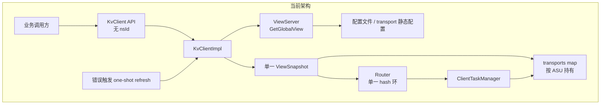

M800 架构把控制面和 IO 面分开。Master 是唯一加载 Ceph KVClientAgent 的角色，Worker 只访问 Master 的只读视图服务；两类角色都实现同一个 `ViewServer::GetAllViews()`，因此 RefreshScheduler、ViewUniverse 和 KvClientImpl 不需要感知 Master/Worker 差异。

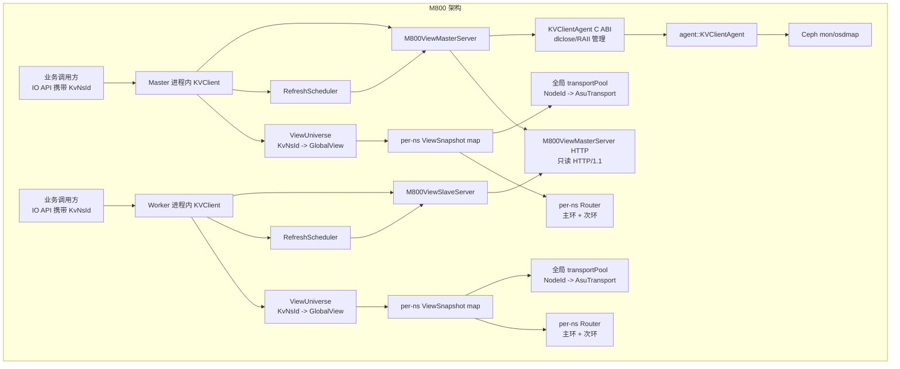

实现侧统一命名为 `M800ViewMasterServer`，Worker 侧实现命名为 `M800ViewSlaveServer`；`view.role=worker` 仍表示部署中的 Slave 角色。

## 4. 核心思路

M800 的核心是以 `KvNsId` 为主键组织视图，并把“视图归属”和“连接归属”拆开。

1. **视图按 ns 隔离**：每个 `KvNsId` 对应一个 `GlobalView`，拥有独立的 `viewEpoch`、ASU 成员和 Router。IO 提交时按 `nsId` 选择快照，快照替换不影响已经在途的任务。
2. **连接按 NodeId 全局去重**：ASU 节点可以同时出现在多个 ns 的视图中，同一个 NodeId 只创建一个 `AsuTransport`。transport 全局池是物理连接的唯一持有方，per-ns 快照只引用池内对象。
3. **Master/Worker 统一抽象**：Master 和 Worker 都暴露为 `ViewServer::GetAllViews()`。Master 内部调用 KVClientAgent，Worker 内部调用 HTTP；上层刷新和快照构建不感知角色差异。
4. **全量拉取、按 epoch 发布**：Worker 每次 HTTP 拉取全量视图，Master 用 `globalEpoch` 决定 200 或 304；客户端发布时按 per-ns `viewEpoch` 和成员变化增量构建快照。
5. **刷新失败保留旧状态**：agent 或 Master 不可达、返回空 map、hash 冲突或 BuildSnapshot 失败时，不清空任何 ns，新 IO 继续使用旧快照。
6. **IO 失败先刷新再重试由上层决定**：客户端刷新是异步的，不在 IO 关键路径阻塞等待。任务失败后触发 RefreshScheduler，下一批任务使用新视图。
7. **默认二次哈希只解决可用性**：主归属不可用时用次哈希选 fallback；次归属也不可用则该 entry 失败。KVClient 不迁移数据，一致性由上层 TTL/GC 或重写收敛。

## 5. 设计要点

### 5.1 二级视图模型

```cpp
using KvNsId = std::uint32_t;

class ViewUniverse {
public:
    Status PublishAll(const ViewUniverse& nextUniverse);
    Status ReplaceAll(const ViewUniverse& nextUniverse);
    Status GetView(KvNsId nsId, GlobalView& view) const;
    std::unordered_map<KvNsId, GlobalView> GetAllViews() const;
    std::vector<KvNsId> GetAllNsIds() const;
    std::uint64_t GetGlobalEpoch() const;
    bool Empty() const;
    void Clear();

private:
    mutable std::mutex mutex_;
    std::unordered_map<KvNsId, GlobalView> views_;
    std::uint64_t globalEpoch_{0};
};
```

`GlobalView` 保持现有结构，新增语义如下：

- `asuMap` 的 key 是 ASU/OSD 的 `NodeId`。
- `viewEpoch` 来自 `KVClientAgent::get_epoch()`，表示 Ceph 视图版本。
- Master 是唯一权威源，Worker 不自行推进 epoch。
- 空 `views` 是错误数据，不能被解释为“所有 ns 被删除”。
- `ViewUniverse` 是维护集群视图的模块，不是可随意写成员的值对象；更新和查询都必须经过它的公开接口。
- `PublishAll` 使用全局 epoch 做单调校验，`ReplaceAll` 用于 ViewServer 输出对象的初始化替换，二者都在锁内完成原子替换。

`ViewServer` 增加虚函数：

```cpp
virtual Status GetAllViews(ViewUniverse& universe)
{
    GlobalView view;
    auto status = GetGlobalView(view);
    if (!status.ok()) { return status; }
    universe.views[defaultNsId] = std::move(view);
    return Status::OK();
}
```

默认实现保证旧派生类仍然可用。旧配置路径返回的视图映射到固定 `defaultNsId`；M800 路径则返回真实多 ns map。`defaultNsId` 可以设为 `0`，但如果 M800 pool hash 结果为 `0`，必须优先保证新旧路径不混用，而不是为同一个客户端同时启用两套 provider。

### 5.2 nsId 与 Ceph pool 映射

Ceph 侧的 ns 名称就是 pool name。Master 执行以下流程：

```text
pool_name -> UTF-8 bytes -> XXH32(bytes, 5381) -> uint32_t KvNsId
```

约束：

1. seed 必须全局固定；本设计使用 `kKvNsIdHashSeed = 5381`。
2. 不使用 pool id 作为 `KvNsId`，因为外部 IO API 和存储协议已经使用 32 位 nsId，固定哈希便于跨语言、跨进程一致。
3. Master 每次拉取 `get_all_ns_name()` 后构建 `pool_name -> nsId` map，并检测重复 value。
4. 发现冲突时返回错误并保留旧 `ViewUniverse`。
5. `ViewUniverse` 不维护 `nsName`。Master 在调用 Agent 后立即把 pool name 转换为 `KvNsId` 并完成冲突检测；Worker 只消费 Master 已编码的 nsId。

一次 IO 请求假定所有 key 或 entry 属于同一个 `KvNsId`。如果未来 API 允许逐 entry 指定 ns，需要先在 Client 层按 ns 拆分任务，再进入路由和协议构建；本设计不默认支持混合 ns 任务。

### 5.3 Master/Worker 角色

配置由 `view.provider=m800` 显式启用。

Master：

- `dlopen(view.ceph.agent_lib)`。
- 通过新增 C ABI 创建 KVClientAgent。
- 使用 mon host、client name 和 keyring 认证初始化。
- 启动 agent 内部视图刷新线程，并等待首个非空 OSDMap。
- 获取全部 ns name，逐个调用 `get_view_by_ns(ns, up=true, in=true)`。
- 将 OSD 视图转换为 `GlobalView`。
- 启动只读 HTTP/1.1 服务，向 Worker 提供 `GET /v1/views?since_epoch=<lastEpoch>`。

Worker：

- 不加载 agent 动态库。
- 连接 `view.master_addr` 拉取视图。
- 完全信任 Master 返回的 `globalEpoch` 和 per-ns `viewEpoch`。
- Master 不可达时保留旧视图，IO 继续走旧快照。

角色由上层 `Init` 配置传入：

```ini
view.provider=m800
view.role=master
```

`view.role` 未设置时建议默认 `master`，但必须在 provider 为 `m800` 时才解析该字段，避免影响旧配置。

当前 `KVClientAgent::start()` 会启动 agent 内部 refresher；M800 的 `RefreshScheduler` 仍然保留，两者职责不同：agent refresher 维护 `libkv_agent.so` 内部的 OSDMap，RefreshScheduler 把当前 OSDMap 快照转换并发布到 KVClient 的 `ViewUniverse`。因此两个刷新间隔可以配置为同一个值，但不应删除任何一层。

Master 首次 `GetAllViews()` 时，agent 可能刚启动、OSDMap 尚未到达。初始化流程应在 `view.ceph.agent_fetch_timeout`（建议默认 10 秒）内以 100~200ms 间隔重试，直到 `get_epoch() != 0` 且 `get_all_ns_name()` 非空。超时后 `Init` 失败。该等待发生在初始化阶段，不阻塞初始化完成后的前台 IO。

### 5.4 KVClientAgent C ABI

新增独立 C ABI，不复用 `kv_agent_create`。建议头文件提供：

```c
typedef struct kv_client_agent_handle kv_client_agent_handle;

typedef struct kv_client_agent_config {
    const char* mon_host;
    const char* client_name;
    const char* client_key;
    const char* log_dir;
    int32_t view_refresh_interval;
    int32_t view_fetch_timeout;
} kv_client_agent_config;

typedef struct kv_client_agent_node_view {
    int32_t osd_id;
    int32_t up;
    int32_t in;
    const char** addrs;
    size_t addr_count;
} kv_client_agent_node_view;

kv_client_agent_handle* kv_client_agent_create(void);
int32_t kv_client_agent_init(kv_client_agent_handle* handle,
                             const kv_client_agent_config* config,
                             uint32_t abi_version,
                             size_t config_size);
int32_t kv_client_agent_start(kv_client_agent_handle* handle);
int32_t kv_client_agent_get_epoch(kv_client_agent_handle* handle,
                                  uint64_t* epoch);
int32_t kv_client_agent_get_all_ns_name(kv_client_agent_handle* handle,
                                        const char*** ns_names,
                                        size_t* ns_count);
int32_t kv_client_agent_get_view_by_ns(kv_client_agent_handle* handle,
                                       const char* ns_name,
                                       int32_t up,
                                       int32_t in,
                                       kv_client_agent_node_view** views,
                                       size_t* view_count);

void kv_client_agent_free_ns_names(kv_client_agent_handle* handle,
                                   const char** ns_names,
                                   size_t ns_count);
void kv_client_agent_free_node_views(kv_client_agent_handle* handle,
                                     kv_client_agent_node_view* views,
                                     size_t view_count);
void kv_client_agent_destroy(kv_client_agent_handle* handle);
```

设计约束：

- 返回 C 结构体数组，不跨动态库边界传递 STL 容器、迭代器或 C++ 异常。
- 所有导出函数使用 C linkage。
- ABI version 必须校验。
- `dlopen/dlsym/dlclose` 由 RAII 封装，`dlclose` 在 agent destroy 之后执行。
- `get_view_by_ns` 的节点数组由调用方通过 free 函数释放。
- Agent 内部使用线程锁保护刷新线程和查询线程之间的数据结构。

Shard 1 冻结 `M800ViewAgentClient` 作为 Master 进程内的 C++ 适配边界：

```cpp
class M800ViewAgentClient {
public:
    virtual Status Initialize() = 0;   // C ABI init
    virtual Status Start() = 0;        // C ABI start
    virtual void Stop() = 0;           // C ABI stop
    virtual Status GetEpoch(std::uint64_t& epoch) const = 0;
    virtual Status GetAllNsNames(std::vector<std::string>& nsNames) const = 0;
    virtual Status GetViewByNs(const std::string& nsName, bool up, bool in,
                               std::vector<M800AgentNodeView>& views) const = 0;
};

class M800ViewAgentClientFactory {
public:
    virtual Status Create(const M800ViewServerConfig& config,
                          std::unique_ptr<M800ViewAgentClient>& client) const = 0;
};
```

`Create()` 只负责加载动态库并创建句柄：`dlopen(agentLibPath, RTLD_NOW | RTLD_LOCAL)`，`dlsym` 全部必需符号，调用 `kv_client_agent_get_abi_version()` 校验版本，再调用 `create`。`Initialize()` 才调用 C ABI `init`，传入 mon host、client name、raw key、log dir、刷新间隔和拉取超时。`Start()` 调用 C ABI `start`。`Stop()` 调用 C ABI `stop`；`destroy` 与 `dlclose` 由 RAII 析构顺序保证，且 `dlclose` 必须发生在 `destroy` 之后。

现有 C++ `KVClientAgent` 的 `get_all_ns_name()`、`get_view_by_ns()` 和 `get_epoch()` 只能通过返回值表达数据，不能直接表达错误。C ABI 必须返回 `int32_t` 状态码。实现上可以二选一：

1. 为 `KVClientAgentImpl` 增加 status 版本查询接口，C ABI 只是薄封装；
2. C ABI 包装层把 `epoch == 0`、空 ns 列表、空 up/in 节点列表映射为 `KV_CLIENT_AGENT_EMPTY_VIEW`。

初版可以采用方案 2，因为 M800 要求成功视图必须非空。但这不是长期最优方案；后续应在 agent 内部补齐状态返回，避免把“pool 不存在”“无 crush root”“暂无数据”都折叠为同一个错误。

当前 `KVClientAgentConfig` 的 `client_key` 是 CephX raw secret，不是 keyring 文件路径。提示词配置项是 `view.ceph.keyring=<path>`，实现需要选择一种边界：

1. Master 侧读取 keyring 文件并提取 `[client.xxx] key = <secret>`，再把 raw secret 传给 C ABI；
2. 或 C ABI 增加 `keyring_path`，由 agent 工程自行解析。

初版建议采用方案 1：配置仍使用 `view.ceph.keyring`，`M800ViewServerConfig::Build()` 负责解析并校验。这样 C ABI 与当前 `KVClientAgentConfig` 保持一致。文件格式解析失败时 Init 返回配置错误，不尝试把路径当作 secret 使用。

#### 为什么 Master 不直接持有 `std::unique_ptr<KVClientAgent>`

当前 `libkv_agent.so` 的对外暴露情况如下：

1. 正式 C API 是 [KVAgent.h](../agent/include/KVAgent.h:35) 中的 `kv_agent_*` 系列。这些函数服务 OSD agent 和 pool/crush 管理操作，不是 `KVClientAgent` 的视图查询边界。
2. `agent::KVClientAgent` 是 C++ 类。由于当前构建没有设置 `-fvisibility=hidden`，其构造、析构和成员函数的 mangled symbols 会进入动态符号表，可以被链接方使用；但这只是默认可见性的副作用，不是稳定 ABI。它跨边界返回 `std::vector`、`std::string`，依赖相同编译器、标准库版本、异常/RTTI 配置和类布局。
3. [KVClientAgentABI.h](../agent/include/KVClientAgentABI.h:47) 是本设计新增的 KVClientAgent 视图查询 C ABI 契约。Shard 1 只冻结头文件；agent 侧还需要在后续实现中导出这些 `kv_client_agent_*` 函数。

因此有两种集成方式：

- **链接式集成**：`kv_client` 直接链接 `libkv_agent.so`，Master 持有 `std::unique_ptr<agent::KVClientAgent>`。这要求两个库使用兼容的 C++ ABI，并把 agent 头文件和 Ceph 依赖带进客户端编译边界；`view.ceph.agent_lib` 配置也失去动态加载意义。
- **动态加载式集成**：Master 通过 `dlopen` 加载 so，只 `dlsym` `kv_client_agent_*` C 函数。C 结构体、C linkage、ABI version 和 free 函数让客户端与 agent 的 C++ 实现、STL 和编译配置解耦。

M800 采用第二种方式。`M800ViewAgentClient` 是 C ABI 的进程内 C++ 适配层：把 C 数组转换为 `std::vector`，统一返回 `Status`，并用 RAII 管理 destroy/dlclose。`M800ViewAgentClientFactory` 只承担构造边界，便于默认实现封装 `dlopen/dlsym/create`，测试注入 fake agent。Master 最终持有的是 `std::unique_ptr<M800ViewAgentClient>`，而不是 `std::unique_ptr<agent::KVClientAgent>`。

前向声明只能隐藏头文件依赖，不能单独消除动态库依赖：

```cpp
namespace agent { class KVClientAgent; }

class M800ViewMasterServer {
public:
    ~M800ViewMasterServer();  // 必须放到可见完整类型的 .cc 中定义
private:
    std::unique_ptr<agent::KVClientAgent> agent_;
};
```

这个形式可以让 Master 头文件不 include `KVClientAgent.h`，但只要 `.cc` 调用 `agent_->get_epoch()`、`agent_->get_all_ns_name()` 等成员函数，就会引用 `agent::KVClientAgent` 的 mangled C++ 符号。若直接链接，`libkv_client.so` 仍产生对 `libkv_agent.so` 的 `DT_NEEDED`；若不直接链接，则必须先以 `RTLD_GLOBAL` 加载 agent 并依赖全局符号表解析，这会放大符号污染和 C++ ABI 耦合。若使用 custom deleter 和运行时 factory/virtual interface，可以做到无链接期依赖，但那已经等价于引入一个新的插件 ABI，稳定性和边界清晰度不如 C ABI。

### 5.5 HTTP 视图协议

Worker 请求：

```http
GET /v1/views?since_epoch=<lastEpoch> HTTP/1.1
Host: <master>
Connection: close
```

Master 响应：

- 未变更：`304 Not Modified`，空 body。
- 已变更：`200 OK`，`Content-Type: text/plain`，body 为全量视图文本。
- 服务内部错误：`500 Internal Server Error`，空 body。

Worker 收到 304 时返回“无变更”，不清空旧视图；收到 200 时必须解析完整 body；解析失败视为刷新失败，继续使用旧视图。

HTTP 实现可参考 [standalone_metrics_backend.cc](../metrics/src/standalone_metrics_backend.cc:742) 中 `MetricsHttpServer` 的裸 socket 方案：`getaddrinfo`、`socket/bind/listen`、accept worker、简单 GET 解析、`Content-Length` 和 `Connection: close`。M800 不引入第三方 HTTP 依赖。

Shard 1 冻结通用的 `ViewHttpServer`，让 Master 的业务处理与 socket 细解耦：

```cpp
struct ViewHttpRequest {
    std::uint64_t sinceEpoch{0};
};

enum class ViewHttpReplyKind {
    NOT_MODIFIED,
    FULL_VIEW,
    INTERNAL_ERROR,
};

struct ViewHttpReply {
    ViewHttpReplyKind kind{ViewHttpReplyKind::INTERNAL_ERROR};
    std::string body;
};

class ViewHttpServer {
public:
    virtual Status Start(const std::string& listenAddr,
                         const ViewHttpHandler& handler) = 0;
    virtual void Stop() = 0;
};
```

HTTP server 实现负责协议层：只接受 `GET /v1/views`，解析 `since_epoch`，拒绝非法路径和方法，把 `ViewHttpReplyKind` 映射为 `304/200/500`，写 `Content-Length`、`Content-Type: text/plain` 和 `Connection: close`。Master 注入的 handler 只读当前缓存并生成回复，不直接访问 Ceph Agent。该模块不带 M800 前缀，可被其他只读文本视图服务复用。

安全边界：初版协议只做内网明文传输，Master 监听地址由部署侧限制访问来源。若需要跨安全域暴露，应先增加认证或 TLS，这属于后续增强。

### 5.6 视图文本编码

采用行式 `key=value`，与 `ConfigFileViewServer` 的解析风格一致：

```text
globalEpoch=123
nsCount=2
ns=1009323
viewEpoch=123
viewId=456
asuIds=10,20
asuInfo.10=10.0.0.10:1000
asuInfo.20=10.0.0.20:1000
ns=2004567
viewEpoch=123
viewId=789
asuIds=20,30
asuInfo.20=10.0.0.20:1000
asuInfo.30=10.0.0.30:1000
```

字段语义：

| 字段 | 语义 |
| --- | --- |
| `globalEpoch` | Master 汇总视图版本，用于 304 判断 |
| `nsCount` | ns 数量，用于完整性校验 |
| `ns` | `KvNsId`，32 位无符号整数 |
| `viewEpoch` | per-ns 发布比较 |
| `viewId` | 保留字段，可为 agent epoch 或集群 map version |
| `asuIds` | 当前 ns 的 ASU/OSD 列表 |
| `asuInfo.<nodeId>` | 节点 endpoint |

编码规则：

- 行以 `\n` 结束，不允许值中出现裸换行。
- 协议不携带 pool name；Master 在进程边界内完成 pool name 到 `KvNsId` 的转换和冲突检测。
- 不支持注释行，避免与 pool name 中的 `#` 冲突。
- 解析器必须校验 `nsCount` 与实际 ns 块数量一致。
- endpoint 解析复用 `ParseAsuInfo()` / `TryParseAsuInfoKey()` 风格。

### 5.7 ViewUniverse 发布语义

`ViewUniverse::PublishAll` 只负责视图 map 的校验和原子替换：

1. 拉取结果为空 map：返回失败，保留旧 universe。
2. `globalEpoch` 小于当前值：返回失败。
3. `globalEpoch` 相等：本次刷新结束，不触发快照重建。
4. 任一 ns 没有 routable ASU，或 per-ns `viewEpoch` 大于 `globalEpoch`：返回失败，保留旧 universe。
5. 校验通过后，一次性替换 `views_` 和 `globalEpoch_`。

per-ns 快照的构建和提交属于 Shard 9/10 的 `KvClientImpl` 集成：

1. RefreshScheduler 通过 `ViewServer::GetAllViews()` 拉到完整候选 universe。
2. `KvClientImpl` 对比新旧 universe，得到新增、变更和删除 ns。
3. 先为下一版构建 Router、transport 引用和 `ViewSnapshot`，不在正式 map 上直接修改。
4. 任一 `BuildSnapshot` 失败：本次刷新整体失败，`ViewUniverse` 和所有旧快照保持不变。
5. ns 在全量视图中消失：下一版快照 map 删除该 ns，但不关闭 transport 池对象。
6. 全部下一版快照构建成功后，在同一个提交临界区内替换 `snapshots_` 并调用 `ViewUniverse::PublishAll()`。

“整体原子发布”避免同一个客户端在部分 ns 新 epoch、部分 ns 旧 epoch 的混合状态。Master 的 Ceph cluster epoch 理论上全局推进，因此一次成功全量拉取应能给出一致的版本集合。

### 5.8 RefreshScheduler

`RefreshScheduler` 是常驻线程，而不是每次错误时临时启动线程。

```cpp
class RefreshScheduler {
public:
    Status Start(std::chrono::milliseconds interval, RefreshCallback callback);
    void Stop();
    void TriggerByTimer();
    void TriggerByIoFailure(const Status& status);
    Status RefreshNow();
};
```

内部状态建议：

```text
wakeup_cv + mutex
interval_ms = 30000
stop_flag
manual_requested
io_failure_requested
refresh_in_progress
last_refresh_time
```

调度规则：

- 定时唤醒、IO 失败和手动刷新都只设置标志并 notify，不在调用方线程执行刷新。
- 手动刷新优先级最高，可立即重置下一次定时时间。
- 刷新进行中收到新触发时合并为一次，避免多个刷新并发。
- IO 失败触发不改变固定周期，只在周期之外提前唤醒。
- 刷新失败不回滚已发布视图，也不重置 `last_refresh_time` 到成功值之外；下次定时或失败触发继续尝试。
- `Stop()` 停止接收触发，唤醒线程，join，并等待当前刷新完成。

定时、失败、手动三种触发源进入同一个串行刷新函数，保证不会同时调用 `ViewServer::GetAllViews()` 和 `BuildSnapshot()`。

### 5.9 per-ns 快照与全局 transport 池

M800 的数据结构：

```cpp
std::unordered_map<KvNsId, std::shared_ptr<ViewSnapshot>> snapshots_;
std::unordered_map<NodeId, std::shared_ptr<AsuTransport>> transportPool_;
std::mutex transportPoolMu_;
```

`GetOrCreateTransport()` 的语义：

```text
输入 NodeId + NodeInfo + TransportConfig template
1. lock transportPoolMu_
2. 命中 NodeId -> 校验 endpoint 未变化，返回池内 shared_ptr
3. 未命中 -> clone transport config template
4. template.nodeId = NodeId，template.endpoints = NodeInfo.endpoints
5. 创建 AsuTransport 并 Init
6. Init 成功 -> 插入池并返回
7. Init 失败 -> 不入池，返回错误
```

当前 `KvClientImpl::BuildTransport()` 从静态 `transportConfigs_[nodeId]` 查找配置；M800 的 `NodeId` 来自动态 OSDMap，不能要求部署方预先枚举所有 OSD。因此 M800 路径应引入全局 transport 配置模板：

- `KvClientConfig.transportConfigs` 至少保留一条配置，作为 provider 类型、协议参数、队列深度、超时和内存参数的模板。
- 模板的 `nodeId` 只作占位，不参与视图匹配。
- 为动态 NodeId 创建 transport 时 clone 模板，替换 `nodeId` 和 endpoints。
- 模板中的 `kv_ns_id` 属性必须删除或忽略，因为 M800 协议值来自每个 `TransportTask`。
- `transportConfigs_[nodeId]` 的精确查找继续服务旧单视图路径。

如果池内已存在该 `NodeId`，`GetOrCreateTransport()` 需要比对新 `NodeInfo.endpoints` 与创建时的 endpoints。不一致时返回配置冲突，本次刷新失败并保留旧快照。初版不做同 NodeId 的连接重建，避免部分进程换连接、部分进程仍持有旧连接。

快照与池的关系：

- `transportPool_` 是物理连接的唯一长期持有方。
- `ViewSnapshot.transports` 仅保存对池内 `shared_ptr<AsuTransport>` 的引用。
- ns 快照替换或删除时，只减少 `shared_ptr` 引用，不关闭连接。
- 同一 `NodeId` 出现在多个 ns 时，多个快照引用同一个 transport。
- 物理连接数等于全局去重后的 `NodeId` 数，而不是各 ns ASU 数量之和。
- `Shutdown` drain 后遍历 `transportPool_`，统一调用 transport 关闭并清空池。

当前实现里 `retiredTransports_` 的用途在 M800 路径中不再必要。为避免新旧路径互相影响，M800 可以在配置为 `m800` 时不写入该字段，或在后续重构中删除该字段并让旧路径也统一使用池语义。本文按前者描述。

初版约定同一 `NodeId` 的 endpoint 稳定。若 Master 后续返回同一 NodeId 但 endpoint 变化，常驻池不能直接更新 transport；应先返回视图校验错误或设计 transport 重建流程，避免不同进程对连接语义产生分歧。

### 5.10 二次哈希故障转移

本节是 Shard 7 的目标实现。Shard 1 只冻结 `Router::RouteKeys(keys, unavailableNodes)` 契约；默认实现保持旧行为，不提前引入次哈希函数和次环，避免接口契约与实现 shard 边界交叉。

`RingHashRouter` 需要扩展：

- 主环 hash：CRC32 IEEE。
- 次环 hash：FNV-1a 32/64 位，使用独立 ring 存储。
- `Build()` 同时构建主环和次环。
- `RouteKeys(keys, unavailableNodes)` 接收不可用节点集合。

单 key 路由规则：

```text
primary = 主环 lower_bound(hash_primary(key))
if primary 可用:
    return primary

fallback = 次环 lower_bound(hash_secondary(key))
if fallback 可用:
    return fallback

return kInvalidNodeId / entry routing failure
```

语义：

- 不做第三次重试。
- fallback 等于 primary 且 primary 不可用时，同样失败。
- 主节点恢复后，下一批 IO 自动回到主哈希归属。
- 已写到次归属的数据不自动迁移。
- 环成员变化后，写总是发新归属；读发新归属，若数据仍在旧节点，不保证成功。
- 一致性由上层 TTL/GC 或重写收敛。

当前 Router 还有 Maglev、ContiguousBlockAffinity 和 BatchTopKAffinity。二次哈希默认能力应限定在 `RingHashRouter`。如果其他策略配置了 M800，应返回 unsupported 或明确声明该策略不提供 fallback。

不可用节点由 `BuildTransportTasks()` 在当前 ns 快照内收集。健康判断调用 transport 的 `CheckHealth()`；若某类 transport 没有轻量健康探测，则先按可用处理，避免把未实现的检查误判为故障。

### 5.11 IO 路径 nsId 传递

外部 IO API 和 IO 命令携带 `KvNsId` 是本设计的前提，由其他开发者在外部分支实现。Shard 1 不修改 `ClientTask`、`TransportTask`、`ViewSnapshot` 和请求编码层的字段；Shard 9 再把这些字段接入多 ns 快照选择和协议构建。

外部 API 已携带 `KvNsId`，Client 内部需要按以下路径传递：

```text
Query/Load/Store/Delete(nsId, ...)
  -> ClientTask.nsId
  -> task->viewSnapshot = snapshots_[nsId]
  -> TransportTask.nsId
  -> SQE/KV protocol request.kv_ns_id
```

要求：

- 未知 ns 返回 `NOT_FOUND`，消息带 `nsId`。
- 提交任务时复制 `shared_ptr<ViewSnapshot>`，后台刷新不改变该任务路由。
- 每个请求构建函数都从 `TransportTask.nsId` 取值，不再读取 `TransportConfig.attrs["kv_ns_id"]`。
- `attrs` 中的 `kv_ns_id` 可以保留给旧单视图路径，但 M800 路径必须优先使用 task 值。

## 6. 实现思路图

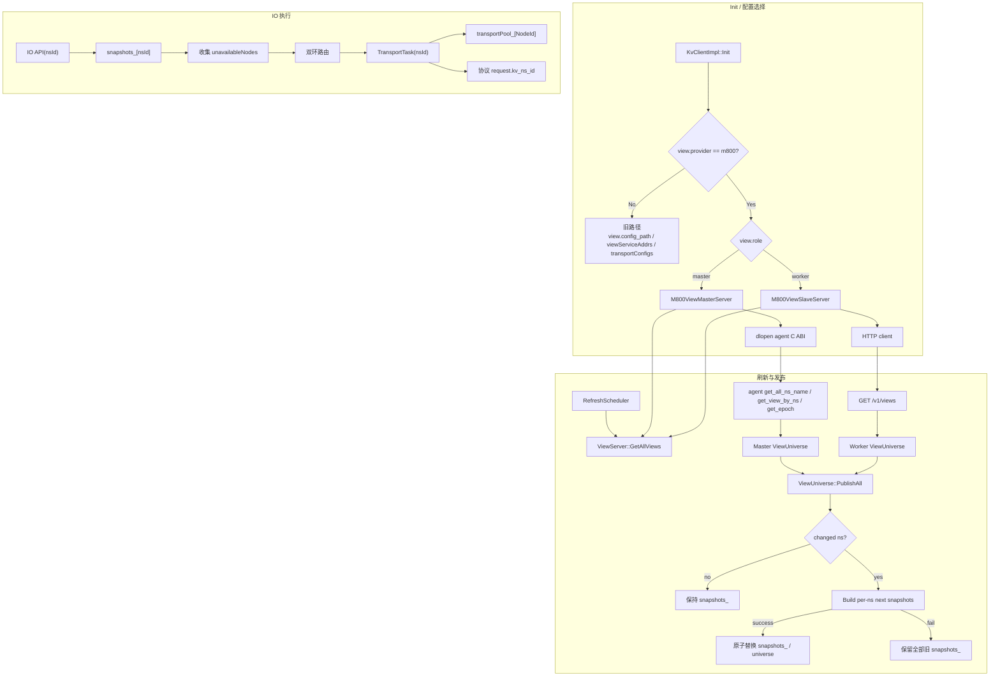

## 7. 模块设计

### 7.1 `M800ViewServerConfig`

```cpp
struct M800ViewServerConfig {
    std::string role;                 // master / worker
    std::string listenAddr;           // master only
    std::string masterAddr;           // worker only
    std::string monHost;              // master only
    std::string clientName;           // master only
    std::string keyringPath;          // master only
    std::string clientKey;            // parsed raw secret, internal
    std::string agentLibPath;         // master only
    std::uint64_t agentFetchTimeoutMs{10000};
    std::uint64_t httpTimeoutMs{10000}; // worker only
    std::uint64_t refreshIntervalMs{30000};

    static Status Build(const KvClientConfig& config,
                        M800ViewServerConfig& m800Config);
};
```

校验规则：

- master 必填：`mon_host`、`client_name`、`keyring`、`agent_lib`。
- worker 必填：`master_addr`。
- `listen_addr` 默认 `0.0.0.0:9100`。
- `refresh_interval_ms` 默认 30000，最小建议 1000。
- `agent_fetch_timeout` 默认 10 秒，仅 master 使用。
- `http_timeout` 默认 10 秒，仅 worker 使用。
- master 和 worker 的配置字段交叉出现时返回配置错误，防止误部署。

### 7.2 `M800ViewMasterServer`

职责：

1. 管理 agent 动态库和 C ABI 句柄。
2. 初始化 KVClientAgent 并建立 Ceph 连接。
3. 拉取全部 ns 和每个 ns 的 up/in OSD。
4. 转换为 `ViewUniverse`。
5. 提供 `GetAllViews()`。
6. 启动只读 HTTP 服务。

依赖边界：

```text
M800ViewMasterServer
    -> M800ViewAgentClientFactory  // Shard 3 默认实现执行 dlopen/dlsym/create
    -> M800ViewAgentClient         // Initialize/Start/Stop/查询
    -> ViewHttpServer          // Start/Stop
    -> M800ViewCodec               // HTTP body 编码
    -> ViewUniverse                // 内部只读缓存
```

启动顺序：

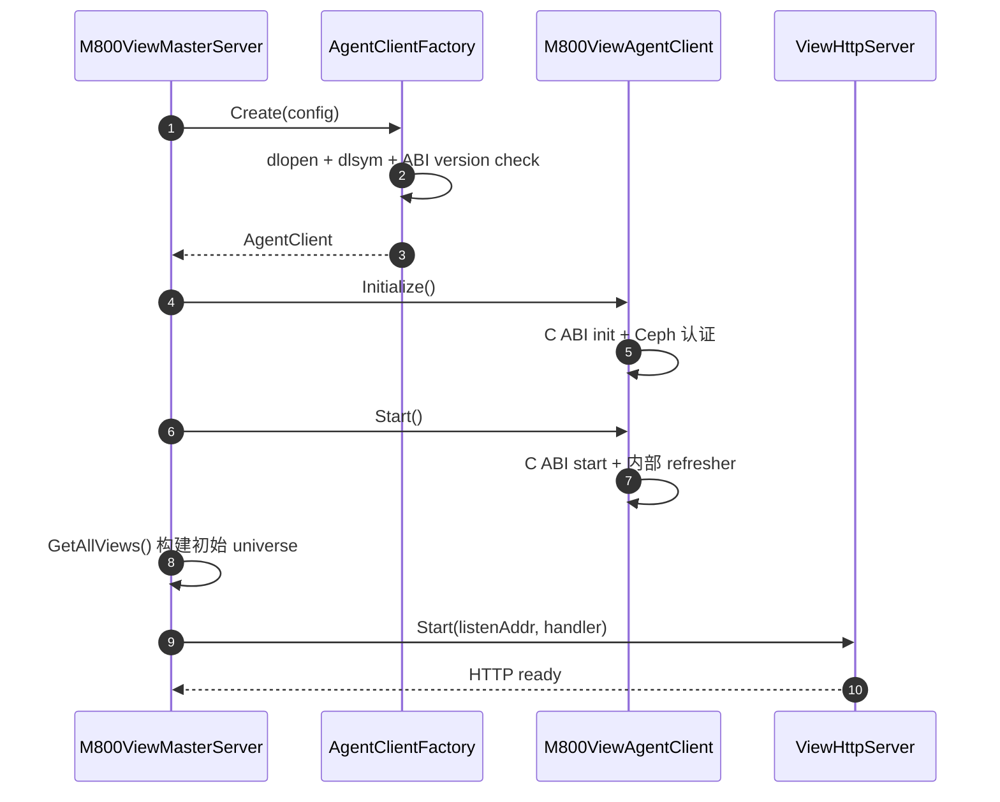

`Start()` 失败时的回退规则：

- `Create/Initialize/Start/初始 GetAllViews` 任一步失败，均不启动 HTTP 服务。
- 已经创建的 agent client 必须执行 `Stop()` 并由 RAII 完成 destroy/dlclose。
- `Stop()` 幂等，先停止 HTTP accept 和请求处理，再停止 agent，避免新请求访问已销毁缓存。

刷新与查询边界：

- `M800ViewMasterServer::GetAllViews()` 负责从 Agent 拉取一致快照、转换并更新内部缓存，然后向调用者返回副本。
- HTTP handler 不调用 Agent，也不触发刷新；它只在锁保护下读取当前 `ViewUniverse` 缓存。
- 刷新线程和 HTTP 请求线程可以并发，但二者不能同时修改缓存；Agent 拉取在缓存锁外执行，提交阶段才替换缓存。

节点转换：

```text
KVClientNodeView.osd_id  -> GlobalView.asuMap key / NodeId
KVClientNodeView.addrs   -> NodeInfo.endpoints
agent.get_epoch()        -> GlobalView.viewEpoch
```

过滤条件固定为 `up=true` 和 `in=true`。不把 down/out 节点放入可路由视图，避免 Router 初始路由到明显不可用节点。

为了得到一致的全量快照，Master 拉取流程应在读取 ns 列表前调用一次 `get_epoch()`，在全部 ns 转换完成后再调用一次。两次 epoch 不同说明 OSDMap 在拉取期间发生变化，本次结果丢弃，等待下个刷新周期；两次相同且非零时，将该 epoch 写入 `globalEpoch` 和每个 ns 的 `viewEpoch`。

Slave 请求处理逻辑固定为：

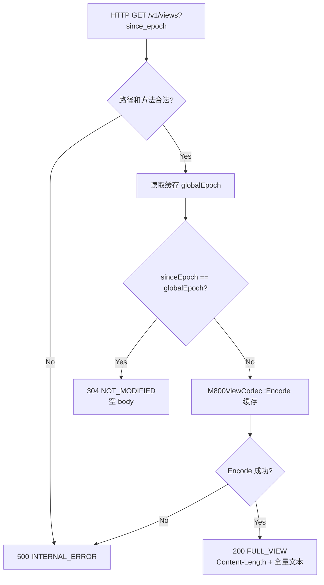

如果 Master 尚未完成初始视图，则不应启动 HTTP 服务；因此正常监听开始后，请求处理不会遇到“空 universe”，编码失败按 500 处理并保留旧缓存。

### 7.3 `M800ViewSlaveServer`

职责：

1. 维护 `masterAddr` 和上次成功的 `globalEpoch`。
2. 发起 `GET /v1/views?since_epoch=<lastEpoch>`。
3. 处理 200/304/错误。
4. 调用 `M800ViewCodec::Decode()`。
5. 返回 `ViewUniverse`。

Worker 不加载 agent，不连接 Ceph，也不缓存 Master 的认证信息。

### 7.4 `M800ViewCodec`

职责：

- `Encode(ViewUniverse) -> text`
- `Decode(text) -> ViewUniverse`
- 校验 `globalEpoch`、`nsCount`、`ns`、`viewEpoch`、`asuIds` 和 endpoint。
- 对非法行、重复 ns、缺失字段返回失败。

该模块被 Master HTTP 服务和 Worker 客户端共用，保证两端编码语义一致。

### 7.5 `ViewUniverse`

`ViewUniverse` 是客户端内部的集群视图模块，负责：

- 保存当前 `ViewUniverse`。
- 保存 `KvNsId -> GlobalView` 二级映射和 `globalEpoch`。
- 通过 `PublishAll` / `ReplaceAll` 执行校验和整体原子发布。
- 提供 `GetView(nsId)`、`GetAllViews()`、`GetAllNsIds()`、`GetGlobalEpoch()` 和 `Empty()` 查询接口。
- 不保存 pool name，不负责拉取外部视图，也不负责构建 transport 或 per-ns snapshot。

per-ns `snapshots_`、全局 transport 池和快照提交顺序由 Shard 8/9/10 的 `KvClientImpl` 集成负责维护。

## 8. 业务交互流程图

### 8.1 启动获取初始视图流程

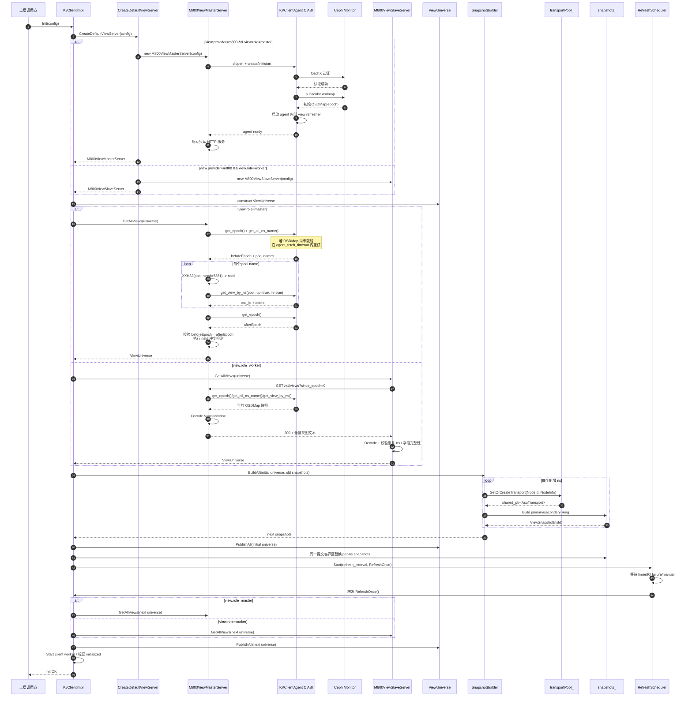

初始视图拉取失败时，`Init` 返回失败。这里不允许“空视图初始化成功”，因为当前客户端启动即需要可路由的 transports；否则所有 IO 都会在启动后立即失败。

该图的职责边界是：

- `CreateDefaultViewServer` 是配置到实现的工厂边界：识别 `view.provider=m800` 和 `view.role`，分别返回 `M800ViewMasterServer` 或 `M800ViewSlaveServer`；`view.provider` 未设置时仍走旧路径。
- 只有 `M800ViewMasterServer` 会 `dlopen` agent 动态库。`KVClientAgent` 负责与 Ceph Monitor 完成 CephX 认证、订阅 OSDMap 并维护本地快照；KVClient 不直接连接 Monitor。
- `M800ViewSlaveServer` 不加载 agent，只向 Master 的只读 HTTP 服务请求视图文本。
- `ViewUniverse` 不负责拉取外部视图，只负责校验、保存和查询 `KvNsId -> GlobalView` 映射。
- `KvClientImpl` 负责对比新旧 universe、构建 per-ns snapshot，并在同一提交临界区里替换 snapshot map 和调用 `ViewUniverse::PublishAll()`。
- `RefreshScheduler` 在初始快照发布后启动，后续通过定时、IO 失败和手动触发调用 `RefreshOnce()`；调度器只执行回调，不直接依赖 ViewServer。

### 8.2 视图变更刷新流程（RefreshScheduler 驱动）

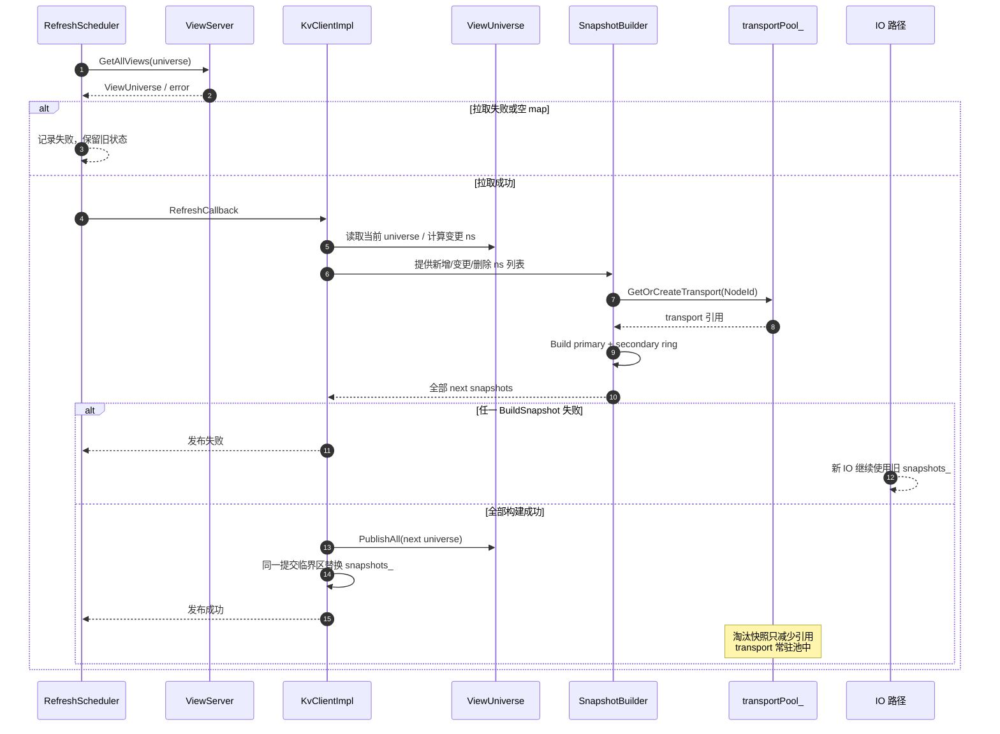

刷新成功后，ns 删除会从新 `snapshots_` 中移除该 ns 的快照；该 ns 后续 IO 返回 `NOT_FOUND`。transport 不会因为被某个或所有 ns 淘汰而关闭。

### 8.3 Refresh Scheduler 三种触发源时序

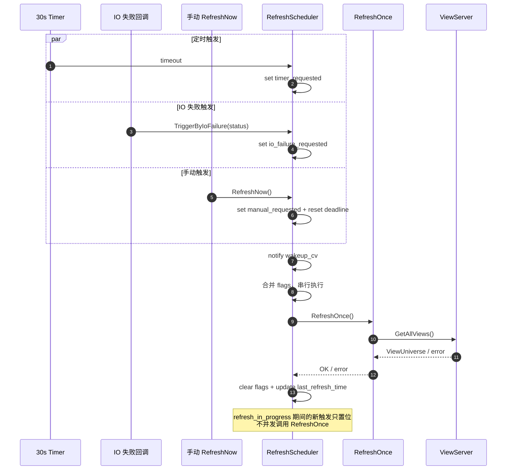

手动 `RefreshNow()` 的返回语义建议为“触发已受理并完成一次刷新”，适合测试和管理接口；如果调用方只要求非阻塞，可以改为返回触发状态。为避免前台 IO 阻塞，公开 IO API 不应调用该同步版本。

### 8.4 M800ViewMasterServer 委托 KVClientAgent 拉取多 ns 视图时序

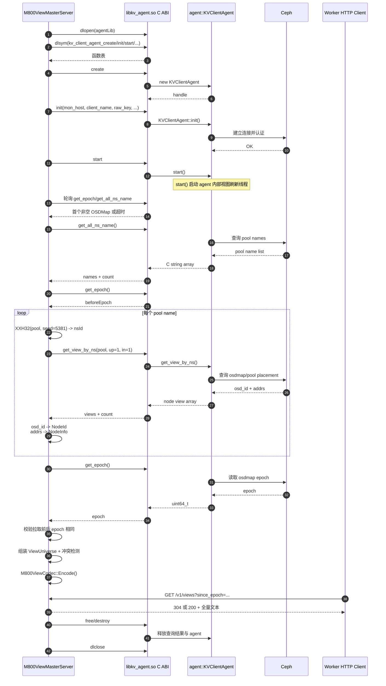

刷新路径中，M800ViewMasterServer 应先拉取完成并更新内部只读快照，再响应 Worker 请求。请求处理线程只读取 mutex 保护的快照，不在 HTTP accept 线程里直接执行 Ceph 查询，避免慢请求互相阻塞。

### 8.5 二级视图数据映射流程

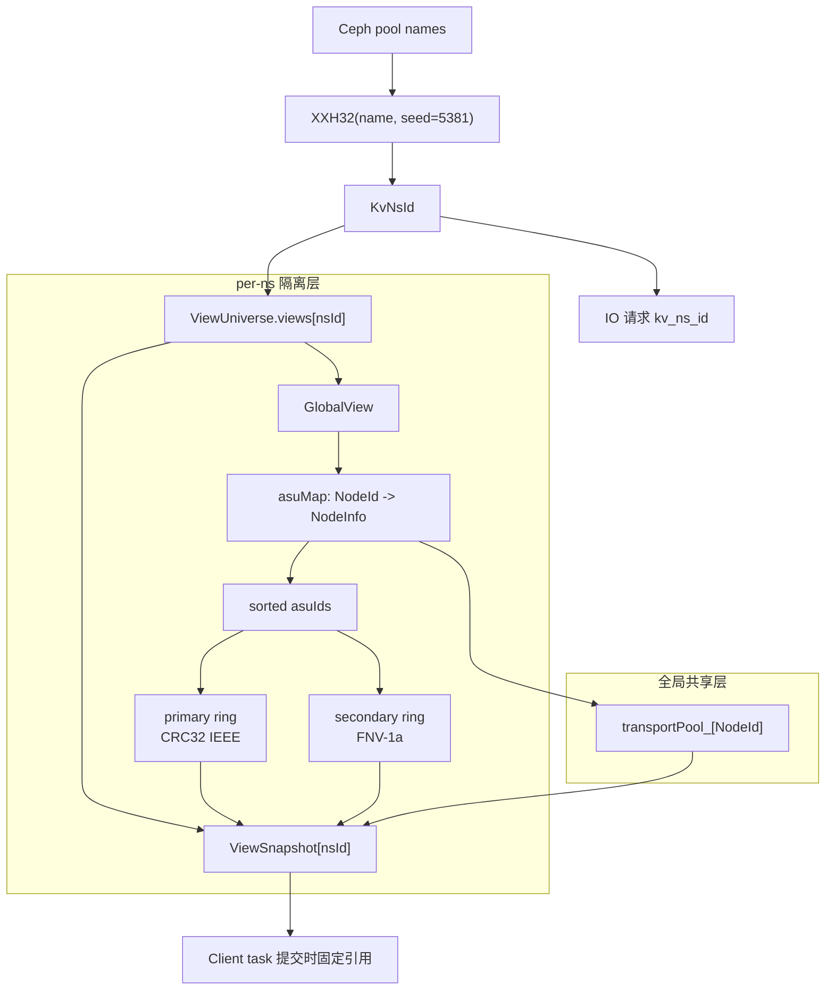

同一 `NodeId` 在多个 ns 中出现时，Router 和快照按 ns 独立，transport 按全局 NodeId 去重。`KvNsId` 与 `NodeId` 是两个不同概念：前者选择命名空间和快照，后者在该命名空间内选择 ASU 节点。

### 8.6 快照生命周期与旧 IO 保活时序

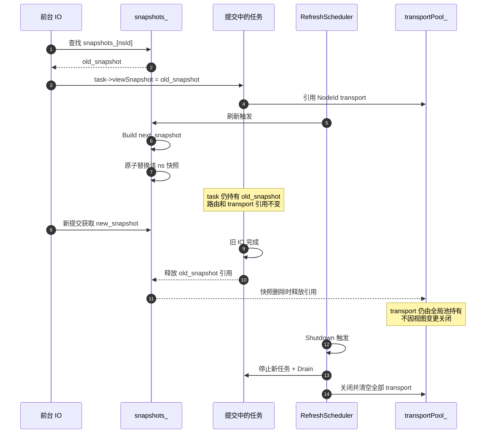

`Shutdown` 的建议顺序：

1. 拒绝新任务提交。
2. 停止 RefreshScheduler 并 join。
3. 停止 client worker。
4. Drain 已提交任务。
5. 关闭 `transportPool_` 内全部 transport。
6. 清理内存注册状态。

由于 transport 常驻池，`retiredTransports_` 不参与 M800 的关闭路径。若保留该成员给旧路径使用，M800 Shutdown 只处理池内对象，避免双重关闭。

### 8.7 故障转移 IO 路径时序（二次哈希）

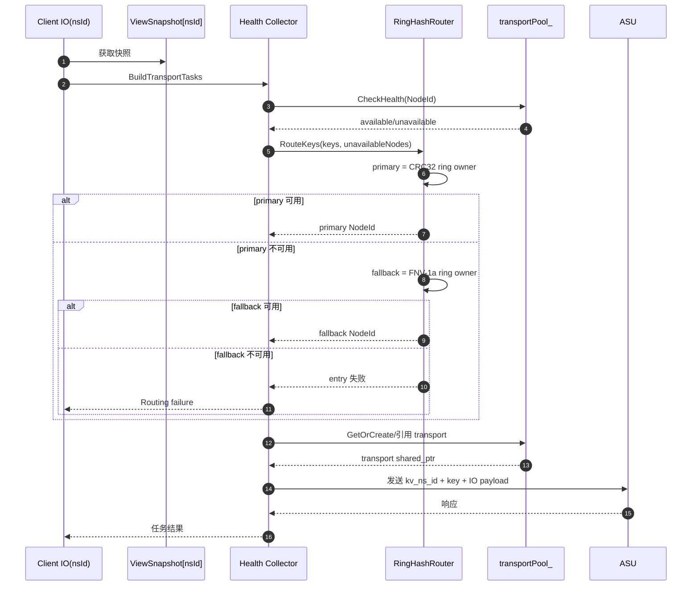

二次哈希是路由层可用性策略，不是数据副本策略。fallback 写成功的数据不会自动回到主归属；主节点恢复后，新写和可路由读仍按新主归属执行。

### 8.8 transport 跨 ns 共享构建时序

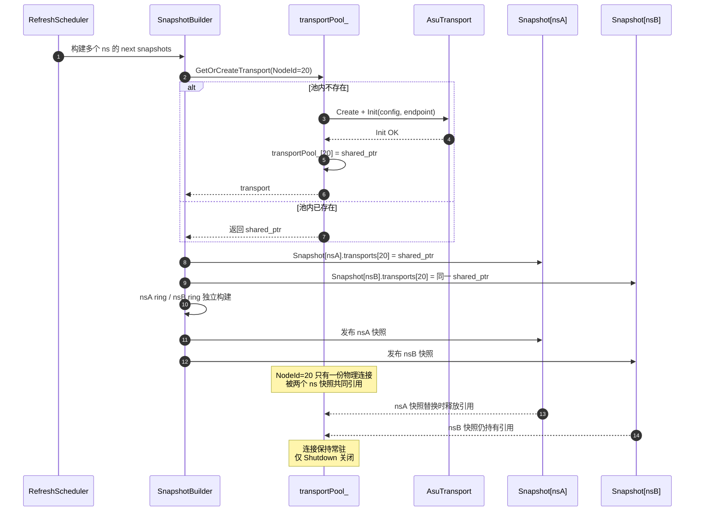

`GetOrCreateTransport()` 需要在锁内判断是否已存在，避免两个 ns 并发构建时重复创建同一个 NodeId。M800 当前刷新串行执行，但锁仍然必要，因为内存注册和未来手动初始化可能引入并发调用。

## 9. 配置示例

Master：

```ini
view.provider=m800
view.role=master
view.listen_addr=0.0.0.0:9100
view.ceph.mon_host=[10.0.0.1:6789,10.0.0.2:6789]
view.ceph.client_name=admin
view.ceph.keyring=/etc/ceph/ceph.client.admin.keyring
view.ceph.agent_lib=/usr/lib/libkv_agent.so
view.ceph.agent_fetch_timeout_ms=10000
view.refresh_interval_ms=30000
```

Worker：

```ini
view.provider=m800
view.role=worker
view.master_addr=10.0.0.1:9100
view.http_timeout_ms=10000
view.refresh_interval_ms=30000
```

旧配置不受影响：

```ini
# 不设置 view.provider，继续走 view.config_path 或 viewServiceAddrs 旧路径
view.config_path=/etc/ucm/asu-view.conf
```

## 10. 状态与错误语义

| 场景 | 客户端行为 |
| --- | --- |
| 初始视图拉取失败 | `Init` 失败，不发布空快照 |
| Master/Agent 临时不可达 | 保留旧 universe，记录警告，等待下个触发 |
| 返回空 ns map | 刷新失败，保留旧 universe |
| `nsId` hash 冲突 | 刷新失败，保留旧 universe |
| HTTP 304 | 无变更，保留旧 universe |
| HTTP 200 解析失败 | 刷新失败，保留旧 universe |
| 任一 ns BuildSnapshot 失败 | 本次整体发布失败，全部旧快照保留 |
| 未知 `nsId` IO | 返回 `NOT_FOUND` |
| 主归属不可用 | 走次哈希 fallback |
| 主/次归属均不可用 | 该 entry 返回路由失败 |
| 视图删除 ns | 新 IO 返回 `NOT_FOUND`，transport 不关闭 |
| `Shutdown` | 停止新任务、drain、关闭全局池 |

日志需要包含 `globalEpoch`、`nsId`、per-ns `viewEpoch`、失败阶段和关键 `NodeId`；Master 侧发生 hash 冲突时可以额外记录被折叠的 pool name。这些字段足以区分 Ceph 拉取失败、HTTP 同步失败、文本解码失败和 transport 初始化失败。

## 11. 测试要点

1. **旧路径回归**：`view.provider` 未设置时，配置文件和静态 transport 视图行为不变。
2. **ViewServer 默认实现**：旧派生类只实现 `GetGlobalView()` 时，`GetAllViews()` 返回单 ns 包装结果。
3. **编码解码**：覆盖多 ns、共享 NodeId、重复 ns、缺失字段、`nsCount` 不一致。
4. **hash 冲突**：模拟两个 pool name 得到同一个 `KvNsId`，刷新失败且旧快照不变。
5. **HTTP 304/200/500**：304 不清空，200 全量替换，500 保留旧状态。
6. **PublishAll**：ns 新增、删除、epoch 不变、epoch 变化、空 map、部分 BuildSnapshot 失败。
7. **RefreshScheduler**：定时触发、失败触发去重、手动触发、Stop 时 join。
8. **快照保活**：刷新过程中提交的旧任务仍持有旧快照并完成。
9. **transport 池**：两个 ns 引用同一 NodeId 只创建一次 transport；ns 删除不关闭；Shutdown drain 后关闭。
10. **二次哈希**：主可用、主不可用 fallback 可用、主和 fallback 均不可用、主恢复后回归主归属。
11. **协议 nsId**：每个请求的 `kv_ns_id` 来自 `TransportTask`，不随共享 transport 配置变化。
12. **Master ABI**：mock 动态库返回 C 数组，校验 free 函数、ABI version 和 destroy 顺序。

## 12. 风险与待确认项

| 事项 | 当前建议 | 需要确认 |
| --- | --- | --- |
| XXHASH32 seed | 使用 `kKvNsIdHashSeed = 5381` | 已冻结，后续不得单侧变更 |
| keyring 解析边界 | Master 侧解析 keyring，提取 raw secret 后传 ABI | 是否希望 agent ABI 直接接受 keyring 路径 |
| endpoint 变化 | 初版视为不支持，返回视图校验错误 | 是否需要支持同 NodeId endpoint 更新和 transport 重建 |
| 混合 ns 任务 | 一次 IO 只允许一个 `KvNsId` | 外部 API 是否可能逐 entry 指定 ns |
| 其他 Router 策略 | M800 默认二次哈希只覆盖 RingHashRouter | 是否要求 Maglev 等策略也提供 fallback |
| HTTP 安全 | 内网明文，监听地址由部署限制 | 是否需要认证或 TLS |

以上未确认项不阻塞主体实现，但必须在编码落地前冻结契约，尤其是 seed 和 keyring 语义，否则不同组件可能生成或解释不同的 `KvNsId`。

## 13. 可独立开发 Shard 拆分

M800 视图管理可以按以下 11 个 shard 并行开发。Shard 1 是所有功能 shard 的契约前置；Shard 11 是工程分支的最终集成收口，必须在 2 至 10 具备后进行。

| Shard | 职责 |
| --- | --- |
| 1. 接口契约层 | 固化所有 shard 共享的接口、类型和数据结构，包括 `ViewServer::GetAllViews()`、`ViewUniverse` 类契约、`KvNsId`、Router fallback 接口、KVClientAgent C ABI 和视图文本协议边界；不修改 IO 任务结构。 |
| 2. `M800ViewServerConfig` | 解析并校验 `view.provider`、`view.role`、Ceph、Master/Slave 地址和刷新参数，为 Master 与 Slave 实现提供角色明确且强校验的运行配置。 |
| 3. `M800ViewMasterServer` | 委托 KVClientAgent 拉取多 ns Ceph 视图并转换为 `ViewUniverse`，同时对外提供只读 HTTP 视图服务。 |
| 4. `M800ViewSlaveServer` + `M800ViewCodec` | 通过 HTTP 从 Master 拉取全量视图文本，并完成编码、解码、格式校验和 nsId 冲突检测。 |
| 5. `ViewUniverse` | 维护 `KvNsId -> GlobalView` 二级映射，执行 epoch 校验、全量对齐、per-ns 查询和失败时保留旧视图。 |
| 6. Refresh Scheduler | 以独立线程统一处理定时刷新、IO 失败触发和手动 `RefreshNow()`，保证刷新请求串行合并执行。 |
| 7. `KvClientImpl` 路由与故障转移 | 扩展 `RingHashRouter` 的主环/次环、不可用节点集合和二次哈希 fallback，并在任务构建层接入健康判断。 |
| 8. `KvClientImpl` 全局 Transport 池 | 引入 `NodeId -> AsuTransport` 常驻池、动态 transport 模板和 Shutdown 统一关闭，保持跨 ns 连接复用。 |
| 9. `KvClientImpl` 多 ns 快照与 IO 传递 | 维护 `KvNsId -> ViewSnapshot`，把 `nsId` 从 Client task 传递到 Transport task 和协议请求，实现 per-ns 快照选择与旧 IO 保活。 |
| 10. `KvClientImpl` 刷新与原子发布 | 接入 RefreshScheduler，拉取候选 universe，对比新旧视图并整体构建、校验、提交 per-ns 快照，失败时保留旧状态。 |
| 11. 工程分支扩展 | 在 `CreateDefaultViewServer` 和配置入口识别 `view.provider=m800` 与 `view.role`，完成各 shard 的集成、构建和回归收口。 |

### 13.1 接口契约类图

下图冻结 Shard 1 需要交付的接口与类型边界。`ViewSnapshot`、`TransportTask.nsId`、全局 transport 池、Router 次环和多 ns 快照提交属于 Shard 7/8/9/10 的实现契约，不在本图中作为 Shard 1 交付项出现。

```mermaid
classDiagram
    class ViewServer {
        <<interface>>
        +GetGlobalView(view) Status
        +GetAllViews(universe) Status
        +ShouldPublishView(published, fetched) bool
        +ShouldRefreshView(status) bool
        +ShouldRefreshView(result) bool
    }

    class M800ViewServerConfig {
        <<record>>
        +role M800ViewRole
        +listenAddr string
        +masterAddr string
        +monHost string
        +clientName string
        +keyringPath string
        +clientKey string
        +agentLibPath string
        +agentFetchTimeoutMs uint64
        +httpTimeoutMs uint64
        +refreshIntervalMs uint64
        +Build(config, m800Config) Status
    }

    class M800ViewRole {
        <<enum>>
        MASTER
        SLAVE
    }

    class M800ViewMasterServer {
        <<abstract service>>
        +GetAllViews(universe) Status
        +Start() Status
        +Stop()
    }

    class M800ViewSlaveServer {
        <<abstract service>>
        +GetAllViews(universe) Status
        +Stop()
    }

    class M800ViewAgentClient {
        <<interface>>
        +Initialize() Status
        +Start() Status
        +Stop()
        +GetEpoch(epoch) Status
        +GetAllNsNames(nsNames) Status
        +GetViewByNs(nsName, up, in, views) Status
    }

    class M800ViewAgentClientFactory {
        <<interface>>
        +Create(config, client) Status
    }

    class M800AgentNodeView {
        <<record>>
        +osdId int32
        +up bool
        +in bool
        +addrs vector
    }

    class ViewHttpServer {
        <<interface>>
        +Start(listenAddr, handler) Status
        +Stop()
    }

    class ViewHttpRequest {
        <<record>>
        +sinceEpoch uint64
    }

    class ViewHttpReply {
        <<record>>
        +kind ViewHttpReplyKind
        +body string
    }

    class ViewHttpReplyKind {
        <<enum>>
        NOT_MODIFIED
        FULL_VIEW
        INTERNAL_ERROR
    }

    class ViewHttpHandler {
        <<type>>
        +operator()(request) ViewHttpReply
    }

    class M800ViewCodec {
        <<utility>>
        +Encode(universe, text) Status
        +Decode(text, universe) Status
    }

    class M800ViewHTTPContract {
        <<protocol>>
        +kViewsPath
        +kSinceEpochParam
        +kContentType
        +kStatusOk
        +kStatusNotModified
        +kStatusServerError
    }

    class M800ViewTextContract {
        <<protocol>>
        +kGlobalEpochField
        +kNsCountField
        +kNsField
        +kViewEpochField
        +kViewIdField
        +kAsuIdsField
        +kAsuInfoFieldPrefix
    }

    class GlobalView {
        <<record>>
        +viewEpoch uint64
        +viewId uint64
        +asuMap NodeId to NodeInfo
        +createTimeMs uint64
        +expireTimeMs uint64
    }

    class ViewUniverse {
        <<thread-safe module>>
        +PublishAll(nextUniverse) Status
        +ReplaceAll(nextUniverse) Status
        +GetView(nsId, view) Status
        +GetAllViews() map
        +GetAllNsIds() vector
        +GetGlobalEpoch() uint64
        +Empty() bool
        +Clear()
        -views_ map
        -globalEpoch_ uint64
    }

    class RefreshScheduler {
        <<interface>>
        +Start(interval, callback) Status
        +Stop()
        +TriggerByTimer()
        +TriggerByIoFailure(status)
        +RefreshNow() Status
    }

    class RefreshCallback {
        <<type>>
        +Status()
    }

    class Router {
        <<interface>>
        +RouteKeys(keys) map
        +RouteKeys(keys, unavailableNodes) map
    }

    class UnavailableNodeSet {
        <<type>>
        NodeId set
    }

    class KVClientAgentCABI {
        <<C ABI>>
        +GetAbiVersion() uint32
        +Create() Handle
        +Init(handle, config, abiVersion, configSize) int32
        +Start(handle) int32
        +Stop(handle) int32
        +GetEpoch(handle, epoch) int32
        +GetAllNsName(handle, nsNames, count) int32
        +GetViewByNs(handle, nsName, up, in, views, count) int32
        +FreeNsNames(handle, nsNames, count)
        +FreeNodeViews(handle, views, count)
        +Destroy(handle)
    }

    class NodeInfo {
        <<record>>
        +endpoints
    }

    class NodeEndpoint {
        <<record>>
        +ip
        +port
        +protocol
        +attrs
    }

    ViewServer <|.. M800ViewMasterServer
    ViewServer <|.. M800ViewSlaveServer
    M800ViewServerConfig *-- M800ViewRole
    M800ViewServerConfig ..> NodeEndpoint : transport template
    M800ViewMasterServer ..> M800ViewAgentClientFactory : creates agent boundary
    M800ViewMasterServer ..> M800ViewAgentClient : queries Ceph views
    M800ViewMasterServer ..> ViewHttpServer : serves workers
    M800ViewMasterServer ..> KVClientAgentCABI
    M800ViewMasterServer ..> M800ViewCodec
    M800ViewMasterServer ..> M800ViewHTTPContract
    M800ViewSlaveServer ..> M800ViewHTTPContract
    M800ViewSlaveServer ..> M800ViewCodec
    M800ViewCodec ..> M800ViewTextContract
    M800ViewAgentClientFactory ..> M800ViewAgentClient
    M800ViewAgentClient ..> M800AgentNodeView
    M800ViewAgentClient ..> KVClientAgentCABI
    ViewHttpServer o-- ViewHttpHandler
    ViewHttpHandler ..> ViewHttpRequest
    ViewHttpHandler ..> ViewHttpReply
    ViewHttpReply *-- ViewHttpReplyKind
    ViewUniverse o-- GlobalView : KvNsId to GlobalView
    GlobalView o-- NodeInfo : NodeId to NodeInfo
    NodeInfo *-- NodeEndpoint : endpoints
    RefreshScheduler o-- RefreshCallback
    Router ..> UnavailableNodeSet
    M800ViewMasterServer ..> ViewUniverse : fetch output
    M800ViewSlaveServer ..> ViewUniverse : decoded output

    note for ViewServer "GetAllViews has a legacy single-namespace default adapter. M800 concrete servers must override it."
    note for ViewUniverse "Owns and guards the secondary mapping. Pool names are converted before entering this module."
    note for Router "Shard 1 freezes the unavailable-node overload. Secondary ring implementation is Shard 7."
    note for M800ViewTextContract "Text protocol carries nsId, not pool name."
    note for M800ViewAgentClient "Default factory owns dlopen, dlsym, ABI check, create, destroy, and dlclose."
    note for ViewHttpServer "Protocol-only boundary: GET parsing and 304/200/500 mapping; handlers read cached views."
```

契约要点如下：

- `ViewServer::GetAllViews()` 是 Master、Slave 和旧视图服务的统一读取入口。
- `ViewUniverse` 是线程安全的集群视图模块，直接拥有二级映射并对外提供更新和查询接口；不存在 `ViewUniverseStore` 契约。
- `RefreshScheduler` 只依赖回调，不直接依赖 `ViewServer`，避免调度层耦合具体视图来源。
- `Router::RouteKeys()` 增加不可用节点集合，是二次哈希故障转移的统一入口；RingHashRouter 的次环和次哈希实现留在 Shard 7。
- Shard 1 不修改 `ViewSnapshot`、`ClientTask` 或 `TransportTask`；多 ns 快照和 IO `nsId` 传递由外部分支及 Shard 9 集成。
- `KVClientAgentCABI` 是 Master 与 agent 动态库之间的进程内 C 边界，所有数组都必须配 free 函数。
- `M800ViewAgentClient` 是 C ABI 的 C++ 适配契约，负责把 C 数组转为 `std::vector` 并隐藏动态库生命周期。
- `ViewHttpServer` 是 Master 的协议服务契约；请求处理函数只读缓存，不在 HTTP 线程内触发 Ceph 查询。

依赖关系如下：

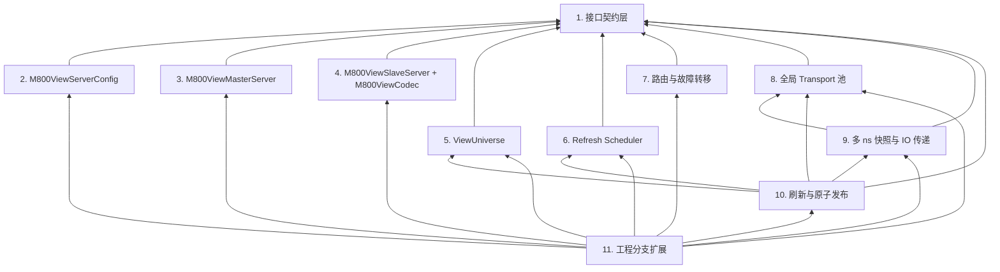

开发节奏建议：

1. 先冻结 Shard 1 的头文件、结构体、错误码和协议格式，允许后续 shard 基于稳定契约并行开发。
2. Shard 2 至 8 可在契约冻结后并行推进；Shard 7 与 8 无直接依赖，9 依赖 8，10 依赖 5、6、8 和 9。
3. 外部 IO API 携带 `KvNsId` 的分支是 Shard 9 的前置条件；若该分支尚未合入，9 只能先完成内部结构与非 IO 路径的单测。
4. Shard 11 最后执行分支合并、默认工厂切换、旧配置路径回归和端到端集成测试，确保 `view.provider` 未设置时旧行为完全不变。
